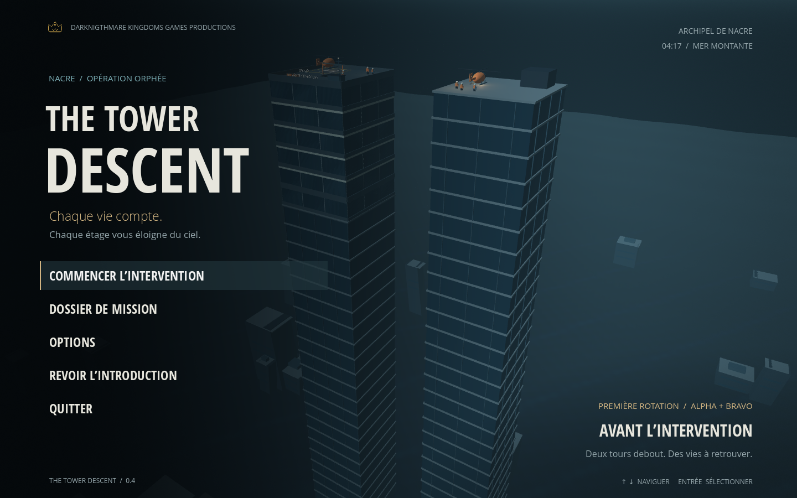

# The Tower Descent

**Version 0.4 — accueil cinématique, introduction en jeu et prototype de sauvetage et d’horreur en vue subjective, accompagné de sa bible de jeu.**

Sur l’île de Nacre, la ville est submergée mais les deux tours Orphée sont encore droites et intactes. Deux hélicoptères déposent Alpha sur Aube et Bravo sur Hespérie, puis repartent devant le retour de la tempête. Pendant votre descente, une réplique fait basculer Hespérie contre votre tour. Vous gardez le contrôle tandis que le décor se transforme, puis poursuivez les sauvetages avec une liaison radio dégradée et Bravo devenu silencieux.

Le titre du jeu est **The Tower Descent**. Le dépôt conserve le nom **The-Descents**.

## Jouer au prototype

### Version Windows

Télécharger [The-Tower-Descent-v0.4-Windows-x64.zip](releases/The-Tower-Descent-v0.4-Windows-x64.zip), extraire le ZIP, puis lancer **TheTowerDescent.exe**. Godot n’a pas besoin d’être installé. L’exécutable n’a pas été lancé sur un PC Windows dans cet environnement ; le détail des contrôles figure dans l’[état de livraison](docs/ETAT_DE_LIVRAISON.md).

**La version recommandée est la 0.4.** Les archives 0.1 et 0.2 sont conservées comme historique. La continuation 0.3 interrompue a été reconstruite et testée dans cette 0.4 ; aucune archive 0.3 n’est présentée comme une livraison validée.

### Projet modifiable dans Godot

Le [ZIP des sources 0.4](releases/The-Tower-Descent-v0.4-Sources.zip) contient le projet modifiable et la documentation. Pour l’ouvrir :

1. Télécharger ce dépôt ou le cloner.
2. Installer [Godot 4.7.2 standard](https://github.com/godotengine/godot-builds/releases/tag/4.7.2-stable), sans .NET. C’est la version utilisée pour les essais de cette livraison.
3. Dans Godot, choisir **Importer**, puis le fichier `prototype/project.godot`.
4. Ouvrir le projet et appuyer sur **F5**. L’accueil permet de reprendre le dernier point sûr ou de préparer une nouvelle intervention.

Avec Godot dans le PATH :

```sh
godot --path prototype
```

Sous Windows, `JOUER_WINDOWS.cmd` lance le même projet si `godot.exe` est dans le PATH ou si l’exécutable Godot se trouve à côté du script. Sous Linux et macOS, `./jouer.sh` utilise la commande `godot` installée.

Le projet ne demande aucun compte, service distant, clé API ou achat d’asset. Il utilise des modèles et matériaux procéduraux et des sons originaux synthétisés. Le moteur jouable est **Godot 4.7.2** ; l’adaptation à Unreal Engine 5 est décrite dans les documents, mais n’est pas réalisée.

## Accueil et mise en scène de la version 0.4



La signature de **Darknigthmare Kingdoms Games Productions** reprend les cartons et la couronne vérifiés dans les autres jeux de l’auteur, avec une adaptation maritime. Les [références précises](docs/REFERENCES_INTRO.md) identifient les fichiers et commits consultés.

- Prologue de **15 secondes** : studio, « présente », auteur et révélation du titre sur les tours intactes ; passage immédiat et replay depuis le menu.
- Accueil dans le monde 3D : approche sans sauvegarde, toit, étage du dernier point sûr ou refuge après la mission. Les dégâts n’apparaissent qu’après leur confirmation dans la sauvegarde.
- Reprise, préparation d’une nouvelle intervention avec confirmation du remplacement, dossier de mission, options, replay et sortie sur ordinateur.
- Approche de **28 secondes** en quatre plans, avec transmissions sous-titrées, bandes cinéma et raccord vers la caméra du joueur. Son horloge est indépendante du temps de mission ; la pause et le passage ne déplacent pas les conditions de progression.
- Musique originale synthétisée, signature sonore et nappe de rotors, réglages de confort persistants et mode caméra réduite avec plans fixes.
- Repli visible de Bravo, accueil nominatif des trois rescapés sur le toit, radio séquentielle et journal consultable depuis le bilan final.

La mise en scène est réalisée en temps réel dans la maquette Godot. Les modèles, animations et enregistrements définitifs d’une production AAA restent à produire. Voir les [scènes et cinématiques](docs/SCENES_CINEMATIQUES.md) et les [captures de contrôle](docs/CAPTURES_V0.4.md).

## Contenu effectivement jouable

Le toit et **six étages distincts**, du 30 au 25, forment une intervention complète :

| Niveau | Lieu | Objectifs et événements |
|---|---|---|
| Toits | Alpha sur Aube, Bravo sur Hespérie | Approche cinématique de 28 secondes en quatre plans, deux hélicoptères, équipes visibles, départ des appareils et consignes radio |
| 30 | Restaurant panoramique | Secourir Ana Rios ; apprendre le retour au treuil |
| 29 | Suites et baie Est | Observer Bravo après le sauvetage d’Ana ; vivre la réplique et l’impact ; collecter Chambre 2908 et récupérer une caisse |
| 28 | Bureaux et archives | Contourner le couloir Est condamné par le noyau ; secourir Samuel Breton et le ramener au treuil |
| 27 | Jardin d’enfants évacué | Découvrir le dessin des deux tours ; respiration sans danger |
| 26 | Spa | Secourir Nora Haddad ; relever SILLAGE 06 ; repousser la silhouette |
| 25 | Refuge technique | Se réapprovisionner et activer le relais après les trois sauvetages et l’effondrement |

### Vivre l’effondrement

1. Passez l’approche avec **E**, ou laissez ses vingt-huit secondes se dérouler. Descendez au **30**, sécurisez Ana et confirmez son treuillage à la balise orange.
2. Rejoignez la **baie Est du 29**, une fois les hélicoptères partis. Regardez Bravo dans Hespérie pendant **0,8 seconde**, ou utilisez **E** près de la balise d’observation.
3. L’événement enchaîne **8 s d’alerte, 6 s de secousse, 7 s d’effondrement et 4 s d’impact**. Vous pouvez regarder et marcher librement ; aucune mort automatique ni QTE n’est imposé.
4. Les vitres, la position d’Hespérie et les débris restent modifiés. Au **28**, passez par le noyau intérieur pour rejoindre Samuel. Les personnes déjà réceptionnées au toit restent sauvées.

La scène attend la progression et l’observation du joueur. Elle ne démarre pas pendant un portage ou un treuillage. **Échap** fige la séquence ; les mouvements de caméra sont réduits par défaut.

Les personnes sécurisées sont transportées au harnais de façon abstraite : votre déplacement ralentit, puis le treuil les remonte visiblement au toit. Elles sont comptées sauvées après la confirmation du poste de secours. Il n’y a pas encore d’animation complète de portage ou d’IA d’escorte.

### Commandes

| Action | Commande |
|---|---|
| Marcher | ZQSD ou WASD |
| Regarder | Souris ou flèches |
| Courir | Maj |
| S’accroupir | Ctrl |
| Sauter | Espace |
| Interagir, attacher la corde, quitter le rappel à hauteur d’un étage | E |
| Passer l’approche ou confirmer l’observation à la baie Est | E |
| Descendre en rappel | S |
| Remonter en rappel | Z ou W |
| Balancement latéral | Q ou A, et D |
| Poser un ancrage secondaire sur corde | X |
| Lampe | F |
| Fusée lumineuse | G |
| Radio | R |
| Journal | J |
| Pause et confort visuel | Échap |

Approchez une balise orange du puits et appuyez sur **E** avant de descendre. Sur corde, arrêtez-vous près d’une dalle puis appuyez à nouveau sur **E**. Les consignes s’affichent au centre de l’écran. Les ancrages secondaires stabilisent le balancement sans interrompre la ligne principale.

La réserve d’air diminue dans les étages enfumés. Les fusées repoussent la silhouette du spa pendant vingt secondes. Les refuges restent sûrs. Les mouvements de caméra sont réduits par défaut, les dialogues sont sous-titrés et le son peut être désactivé dès le menu. Ces réglages sont mémorisés sur l’appareil.

## Sauvegarde

La progression s’enregistre au départ, après un treuillage confirmé, au refuge 25, ainsi qu’**avant et après l’effondrement**. Elle conserve la graine, les ressources, les indices, les sauvetages et l’état des tours. Une interruption pendant la séquence reprend au point sûr qui la précède ; une reprise après stabilisation conserve les dégâts. Un transport non encore validé n’est pas acquis : la personne réapparaît à son emplacement.

Le schéma de progression est en **version 3**, en conservant le nom local `save_v1.json`. Les schémas 1 et 2 valides sont migrés à la lecture sans inventer d’historique. Les 32 dernières transmissions et les événements radio déjà vécus sont conservés. Les préférences sont stockées séparément dans `preferences.cfg`. Le décor de l’accueil utilise uniquement un point sûr validé ; une sauvegarde corrompue désactive la reprise sans interrompre le menu. Les données ne sont jamais envoyées en ligne.

## Lire la bible et préparer la suite

La bible Word/PDF compte **119 pages A4**, issues de **dix sources Markdown et près de 59 000 mots**. Elle réunit **52 fiches de props**, **30 fiches d’assemblage d’étages**, les motivations des personnages, les valeurs actuelles du gameplay et les scènes de production. Le bestiaire distingue **E00, l’entité du spa implémentée**, de **dix archétypes conçus pour la campagne**. Chaque système sépare ses règles actuelles, ses propositions d’enrichissement et ses critères de validation.

- [Bible 0.4 au format Word](docs/The-Tower-Descent-Bible-v0.4.docx) : document réuni et modifiable.
- [Bible 0.4 au format PDF](docs/The-Tower-Descent-Bible-v0.4.pdf) : document de lecture.
- [Effondrement en direct](docs/EFFONDREMENT_EN_DIRECT.md) : déroulé de la séquence, conséquences et intentions pour la campagne.
- [Bible complète](docs/BIBLE_DU_JEU.md) : univers, personnages, récit, systèmes, horreur, fins et production.
- [Catalogue des étages](docs/CATALOGUE_ETAGES.md) : les trente étages, la tour condamnée, les souterrains, le bunker, le niveau 666 et Mountain Hole.
- [Génération et sauvegardes](docs/SYSTEMES_PROCEDURAUX.md) : données, invariants, reproductibilité et contraintes.
- [Architecture et portage Unreal Engine 5](docs/ARCHITECTURE_ET_PORTAGE_UE5.md) : état réel du prototype et adaptation proposée.
- [Props et interactions](docs/PROPS_INTERACTIONS.md) : fonction, dimensions, états, placement, son et critères de validation des objets.
- [Ennemis et statistiques](docs/ENNEMIS_STATISTIQUES.md) : comportements, paramètres, perception et contre-jeu, en séparant le prototype des cibles de campagne.
- [Gameplay détaillé](docs/GAMEPLAY_DETAILLE.md) : contrôles, ressources, règles, motivations et progression.
- [Scènes et cinématiques](docs/SCENES_CINEMATIQUES.md) : plans, déclencheurs, transitions, son et raccords.
- [Communications et équipes](docs/COMMUNICATIONS_ET_EQUIPES.md) : radio, reprise, rescapés et mise en scène des équipes.
- [État de livraison et vérifications](docs/ETAT_DE_LIVRAISON.md) : portée des essais et fonctions restantes.
- [Relecture des documents](docs/validation/v0.4/DOCUMENT_REVIEW.json) : couverture des pages rendues, corrections résolues et empreintes des deux formats et de leurs dix sources.

**La campagne de trente étages, Alma, la chute dans la piscine, les cavernes, le bunker, les fins et Mountain Hole sont conçus dans les documents. Ils ne sont pas implémentés dans cette version.** Le prototype est solo. Ni Unreal Engine 5 ni Unity n’ont été utilisés pour le compiler.

## Structure

```text
prototype/
  project.godot
  scenes/main.tscn
  scripts/           contrôleur, monde, rappel, interface, génération et sauvegarde
  shaders/           eau procédurale
  assets/audio/      sons originaux du prototype
  tests/             génération, persistance, mission et collisions
docs/                bible, catalogue et conception technique
tools/               scripts reproductibles de fabrication
releases/            archives Windows et sources avec sommes SHA256
dist/                version Web exportée
```

## Vérifier le projet

```sh
godot --headless --path prototype --editor --import --quit
godot --headless --path prototype --script tests/test_generation.gd
godot --headless --path prototype --script tests/test_save.gd
godot --headless --path prototype --script tests/test_mission.gd
godot --headless --fixed-fps 60 --path prototype --script tests/test_routes.gd
godot --headless --path prototype --script tests/test_collapse.gd
godot --headless --path prototype --script tests/test_incident_integration.gd
godot --headless --fixed-fps 60 --path prototype --script tests/test_incident_routes.gd
godot --headless --path prototype --script tests/test_incident_effects.gd
godot --headless --path prototype --script tests/test_team_reactions.gd
godot --headless --path prototype --script tests/test_radio.gd
godot --headless --path prototype --script tests/test_radio_integration.gd
godot --headless --path prototype --script tests/test_cinematics.gd
godot --headless --path prototype --script tests/test_preferences.gd
godot --headless --path prototype --script tests/test_cinematic_integration.gd
```

**Les quatorze suites totalisent 2 037 contrôles réussis**, consignés avec leurs empreintes dans le [rapport de validation](docs/validation/v0.4/VERIFICATION.json). Les tests de mission et d’intégration utilisent des téléportations pour isoler les règles et la persistance. Les deux suites de trajets vérifient **231 segments physiques**, dont l’accès à la baie et le détour du 28 ; elles confirment également six blocages attendus. Ces essais ne certifient pas le rendu ou les performances sur toutes les machines.

Les paquets Windows et Web exportés passent aussi **18 contrôles chacun**, depuis deux répertoires vides avec Godot sous Linux. Ces **36 contrôles distincts** vérifient les ressources réellement embarquées et le cycle de sauvegarde ; ils ne remplacent pas un lancement sous Windows ou une partie dans un navigateur. Le [rapport des paquets](docs/validation/v0.4/EXPORTED_PACK_VERIFICATION.json) précise les empreintes et les limites de cet essai.

## Références et créations

L’idée initiale et les notes sont celles de Darknigthmare. *Gremlins 2* et *Skyscraper* sont des références d’organisation des espaces et de catastrophe verticale ; leurs personnages, modèles, bandes originales et extraits ne sont pas intégrés. Le lien de sirène fourni dans le brief est une référence à examiner, pas un son téléchargé ni livré. Les noms, le programme SILLAGE, les dialogues, les géométries et les sons de cette version constituent une proposition originale de développement.

Godot et les composants qu’il embarque conservent leurs [licences respectives](docs/GODOT_LICENSES.txt), également jointes aux distributions. Les polices Open Sans sont fournies avec leur notice et leur licence Apache 2.0. Ce dépôt ne modifie pas le régime de droits du projet appartenant à son auteur.
