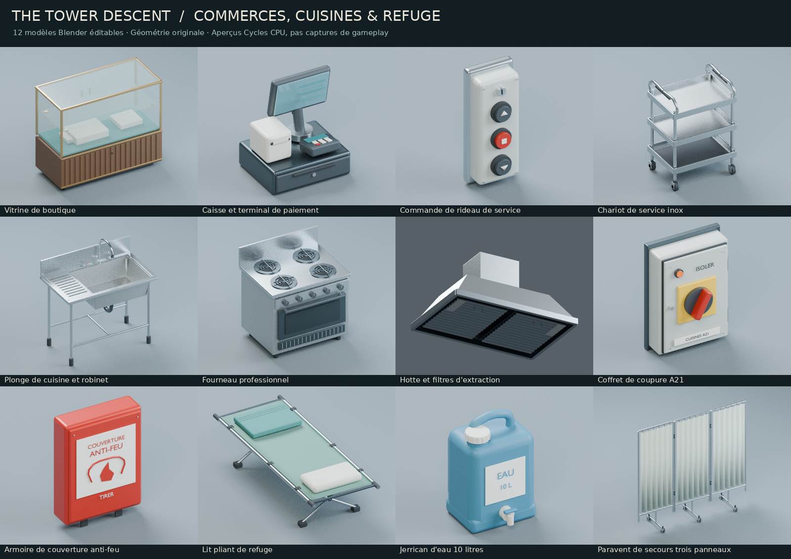
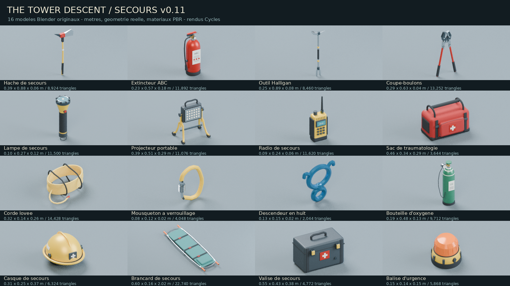
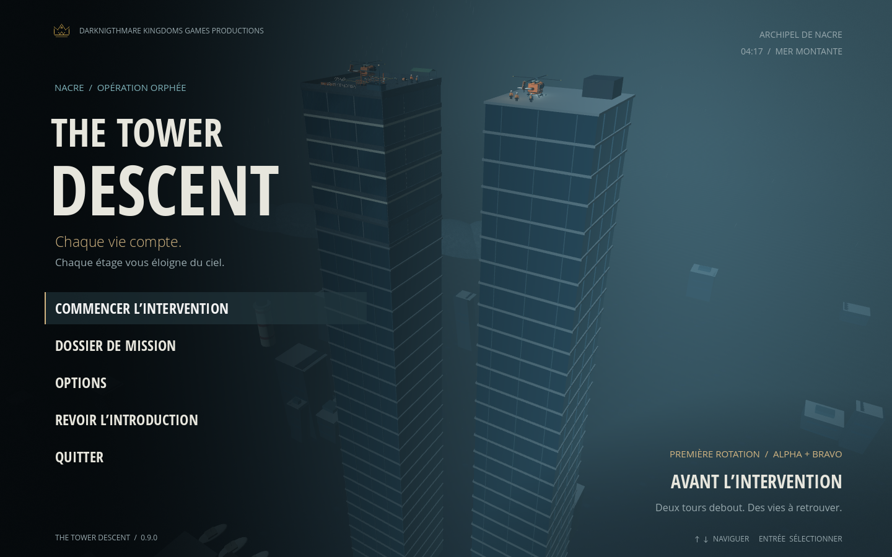

# The Tower Descent

**Version 0.13.0 — candidature : résidences A19–A18 et télécommunications A17.**

La nouvelle tranche reprend au bilan du refuge 20. Jeanne Morel attend dans les résidences du 19, son conjoint Marc dans le duplex du 18 et Inès Vidal dans le local technique du 17. Alex prépare leur départ, dégage le retour de service au Halligan et accompagne les trois personnes jusqu’aux repères du refuge 20. Il revient ensuite au relais du 17 pour transmettre les trois constats du secteur et un bilan fondé sur les arrivées réellement confirmées.

Le rappel du duplex traverse une ouverture avec son appui inférieur visible. Il reste réservé au sauveteur ; les personnes remontent par les escaliers. Le relais exige une destination et une référence comparées à la plaque, avec une saisie réessayable. L’enquête conserve le doute sur Bravo et les événements antérieurs au séisme.

## Accès et documents v0.13

Le projet éditable s’ouvre avec **Godot 4.7.2** depuis `prototype/project.godot`. Les liens suivants sont les **cibles de distribution v0.13** ; la création, la vérification et la publication finales des archives sont encore en cours au statut candidat.

| Format prévu | Usage |
| --- | --- |
| [Windows x86_64](releases/v0.13/TheTowerDescent-v0.13-Windows-x86_64.zip) | Jeu autonome, lanceurs Forward+ et Compatibilité, commandes et licences |
| [Sources Godot](releases/v0.13/TheTowerDescent-v0.13-Godot-Source.zip) | Projet éditable, modèles, sources Blender, textures, tests et documentation |
| [Web](releases/v0.13/TheTowerDescent-v0.13-Web.zip) | Export à servir par HTTP, avec son chargeur, WebAssembly et ressources |

- [Démarrage et commandes](docs/DEMARRAGE_WINDOWS.md) · [État de livraison et limites](docs/ETAT_DE_LIVRAISON.md) · [Formats des exports](docs/EXPORTS.md).
- [Supplément Word v0.13](docs/The-Tower-Descent-Continuation-v0.13.docx) · [PDF v0.13](docs/The-Tower-Descent-Continuation-v0.13.pdf) · [Source complète A19–A17](docs/CONTINUATION_A19_A17_V0.13.md).
- [Douze modèles et source Blender](docs/assets/v0.13/MODELS.md) · [Manifeste des GLB](prototype/assets/models/residential_v013/manifest.json) · [Matières originales et empreintes](prototype/assets/materials/v013/manifest.json).
- [Protocole de validation v0.13](docs/VALIDATION_V0.13.md) · [Revue des pages du supplément](docs/validation/v0.13/DOCUMENT_REVIEW.json).

Les résultats de la 0.12 conservés plus bas sont historiques. Les contrôles finaux, captures natives et vérifications des exports de la 0.13 doivent être lus dans leurs rapports propres ; cette candidature ne reprend aucun ancien total comme certification du nouveau chapitre.

## Parcours des résidences

| Lieu | Action et résultat |
| --- | --- |
| **19 — Résidences hautes** | Préparer le départ de Jeanne près du fauteuil, relever le message des visites, repérer le rappel personnel du duplex |
| **18 — Duplex** | Retrouver Marc, ouvrir la grille du service au Halligan depuis le plateau et consigner la fissure antérieure au séisme |
| **17 — Télécommunications** | Retrouver Inès, alimenter le relais, relever la plaque de routage et comparer les enregistrements |
| **20 — Refuge** | Recevoir physiquement Jeanne, Marc et Inès sur leurs trois repères ouest, distincts des réceptions antérieures |
| **17 — Bilan** | Valider la destination et la référence, maintenir E pour établir la liaison, puis transmettre les constats après les trois réceptions |

**E** donne une consigne de suivi ou d’attente. Jeanne marche plus lentement ; tous s’arrêtent lorsque Alex s’éloigne de plus de cinq mètres. Leur parcours utilise les collisions et les escaliers **S20_19 au nord, S19_18 au sud et S18_17 au nord**. Le rappel **R19_18**, dans le duplex à l’est, sert uniquement aux déplacements d’Alex. Le service devient réversible après son dégagement depuis le 18.

Le chapitre porte le dossier à **onze identités de secours**, **dix pièces possibles** et **seize liaisons locales**. La clôture au 17 exige Jeanne, Marc et Inès reçus au 20, les trois nouveaux constats et la liaison vérifiée. Les huit réceptions des chapitres précédents restent acquises.

## Modèles, textures et lumière

Le lot résidentiel ajoute **douze GLB** : fauteuil, armoire de soins, bibliothèque, table basse, lampe de lecture, interphone, loquet de service, baie télécom, panneau de brassage, alimentation secourue, console relais et enregistreur. La source Blender conserve **428 pièces nommées** ; le manifeste recense **155 152 triangles** et **5 203 300 octets de GLB**. Ces valeurs décrivent le catalogue, pas une mesure de performance en jeu.

Le papier peint en lin et le sol antistatique sont deux créations artistiques natives **1254 × 1254**, conservées avec leurs prompts et empreintes. Le microrelief et la rugosité restent des approximations procédurales. Forward+ conserve les fonctions d’éclairage Godot introduites précédemment ; Compatibilité garde les mêmes lieux et actions avec son rendu direct. Les personnages et une partie de l’architecture restent procéduraux.

## Reprise et progression conservée

Le schéma **6** valide et migre en mémoire les sauvegardes **1 à 5**. Lire un ancien bilan au 20 conserve ce bilan. Le bouton **Poursuivre vers les résidences** enregistre le choix avant de construire les nouveaux étages. Une erreur d’écriture maintient le dernier état durable valide.

Une véritable reprise replace une escorte inachevée en attente à son contact initial. Pendant la session, une erreur d’enregistrement conserve l’escorte vivante et son parcours au lieu de lui appliquer cette normalisation de reprise. Les réceptions confirmées et les interventions achevées restent distinctes des gestes en cours.

## Portée et limites

Le parcours de cette candidature va du toit **31 au 17**. Les tours commencent intactes ; l’effondrement d’Hespérie se produit pendant l’intervention initiale. Le Répondant du 17 est une apparition distante facultative, sans combat ni poursuite. Les niveaux 16 à 1, les laboratoires SILLAGE, la traversée de l’Enfer, Alma, l’intérieur d’Hespérie et le portage UE5 restent des travaux de campagne.

Les essais de logique et de collisions utilisent Godot Linux. Un parcours avec guide synthétique et une capture d’état préparé ont chacun une portée précise ; ils ne certifient pas une partie humaine complète. Monter les ressources d’un export Windows ou Web sous Linux ne lance pas Windows ni le WebAssembly dans un navigateur. Les contrôles finaux de cette candidature restent en cours et aucune performance sur GPU de joueur n’est annoncée.

La [Bible intégrale v0.9 Word](docs/The-Tower-Descent-Bible-v0.9.docx) / [PDF](docs/The-Tower-Descent-Bible-v0.9.pdf) et les suppléments [v0.10](docs/CONTINUATION_A24_A23_V0.10.md) et [v0.12](docs/CONTINUATION_A22_A20_V0.12.md) restent conservés avec leurs preuves historiques.

## Livraison antérieure v0.12

<details>
<summary>Consulter le périmètre et les résultats historiques v0.12</summary>

## Livraison historique v0.12

**Version 0.12.0 — galerie, cuisines et refuge du 20. Revue de la candidature achevée.**

La descente se poursuit du bilan de l’exposition au 23 jusqu’au refuge de logistique du 20. Trois personnes supplémentaires — Mina Bensaïd, Théo Lenoir et Sofia Renard — rejoignent les cinq secours déjà présents. Le nouveau secteur combine des interventions de secours, trois escaliers locaux, un rappel facultatif, deux constats et une première rencontre humaine tendue, sans révéler prématurément les expériences profondes ni l’Enfer.

## Accès et documentation v0.12

- [Guide de démarrage et commandes](docs/DEMARRAGE_WINDOWS.md) · [État de livraison](docs/ETAT_DE_LIVRAISON.md) · [Formats et contenu des exports](docs/EXPORTS.md).
- [Supplément de Bible Word](docs/The-Tower-Descent-Continuation-v0.12.docx) · [PDF](docs/The-Tower-Descent-Continuation-v0.12.pdf) · [Source détaillée A22–A20](docs/CONTINUATION_A22_A20_V0.12.md).
- [Douze nouveaux modèles éditables](docs/assets/v0.12/MODELS.md) · [Deux matières originales](docs/assets/v0.12/TEXTURES.md).
- [21 captures natives examinées](docs/CAPTURES_V0.12.md) · [Observations de revue](docs/validation/v0.12/VISUAL_REVIEW.json).
- [Protocole de vérification](docs/VALIDATION_V0.12.md) · [Contrôles sources](docs/validation/v0.12/VERIFICATION.json) · [Ressources des exports](docs/validation/v0.12/EXPORTED_PACK_VERIFICATION.json).

Le projet éditable s’ouvre avec **Godot 4.7.2** depuis `prototype/project.godot`. La revue est achevée : **8 291 contrôles sources dans 43 suites**, **572 contrôles de packs** — 286 pour Windows et 286 pour le Web —, **21 PNG examinés individuellement par trois agents** et **neuf pages du supplément revues**. Les images comprennent 18 vues Compatibilité et trois vues Forward+ effectivement obtenues. Les rapports portent sur la candidature `9756f0b707c1ffc72284754ec1f1ff301ffdd960`, issue de la source `2e4de42ce85a42c80dae97a1de9985194430d9b6`.

**Archives :** [Windows x64 v0.12](releases/The-Tower-Descent-v0.12-Windows-x64.zip), [Sources v0.12](releases/The-Tower-Descent-v0.12-Sources.zip) et [Captures natives v0.12](releases/The-Tower-Descent-v0.12-Captures-native.zip). Leur disponibilité et leur assemblage vérifié sont attestés par la présence du [manifeste final v0.12](releases/VERIFICATION_V0.12.json), qui donne les tailles et empreintes des trois fichiers. La PR reste en brouillon sur `feat/live-tower-collapse`.

## Ce qui devient jouable

| Secteur | Actions et résultat |
| --- | --- |
| **22 — Galerie des Alizés** | Dégager le volet au Halligan, établir le contact avec Mina, consulter le registre de livraisons nocturnes |
| **22 — Le Retranché** | Garder environ 2 à 3 mètres, abaisser la lampe et maintenir E pour parler ; la rencontre reste facultative |
| **21 — Cuisines** | Isoler le réchauffeur, déployer la couverture coupe-feu puis accompagner Théo ; la fumée locale cesse après validation |
| **21 — Maintenance** | Relever une consigne antérieure au séisme ; une forme distante facultative conserve le doute |
| **20 — Logistique** | Rejoindre Sofia, recevoir physiquement les trois personnes, rétablir le relais et transmettre le bilan |
| **Retour et traversée** | S23_22 au sud, S22_21 au nord, S21_20 au sud ; R22_21 facultatif, avec retour par chaque liaison |

**E** ordonne à une personne de suivre ou d’attendre. Elle marche par les vrais escaliers, s’arrête si Alex s’éloigne de plus de cinq mètres et reste soumise aux collisions. Chaque réception exige son arrivée au repère du refuge avec un appui stable. Le rappel reste une voie personnelle ; une escorte ne traverse pas un étage par téléportation.

Le bilan du 20 exige les trois nouvelles réceptions, le relais alimenté et les deux constats. Les trois personnes du toit et le duo du refuge 25 restent reçus. Le dossier présente jusqu’à **huit personnes**, **sept pièces** et **douze liaisons locales** ; les trois premières pièces restent facultatives pour les bilans suivants.

## Modèles, matières et lumière

Douze modèles supplémentaires complètent les seize accessoires de secours de la 0.11 : vitrine, terminal de paiement, commande de volet, chariot, plonge, fourneau, hotte, coffret de coupure, armoire de couverture, lit pliant, jerrican et paravent. La source `docs/assets/v0.12/commerce_equipment.blend` conserve leurs **485 pièces nommées** ; les douze GLB totalisent **176 430 triangles**. Le terrazzo ivoire et le carrelage sauge conservent leur résolution native **1254 × 1254** avec leurs prompts et empreintes.



Forward+ conserve l’éclairage Godot développé en 0.11 ; Compatibilité propose les mêmes lieux et actions avec son rendu direct. Les personnes, le volet mobile, la fumée et les éléments animés sont exclus des occluders statiques. Les matières sont des créations artistiques, avec des raccords légèrement perceptibles ; les personnages et une partie de l’architecture restent procéduraux.

## Sauvegardes et corrections

Le schéma **5** conserve les anciennes réceptions, indices, interventions, ressources et conséquences de l’effondrement. Les schémas 1 à 4 sont validés puis migrés en mémoire. Lire un ancien bilan ne démarre pas les commerces : **Poursuivre vers les commerces** enregistre d’abord le choix, puis ouvre le secteur. Un échec d’écriture conserve le bilan précédent.

Une escorte inachevée reprend en attente à son contact initial. Les personnes déjà reçues restent au refuge. Le relais du 25 peut servir de point sûr pendant la nouvelle reconnaissance. Un état de santé nul ne remplace plus le dernier checkpoint vivant ; un ancien fichier mortel est conservé et sa reprise désactivée.

Les interactions historiques vérifient désormais portée, visée et obstacles au moment de l’action. Un transfert de rappel obstrué peut être annulé avec **E** pour revenir au départ, en conservant la longe jusqu’à un appui réel.

## Portée actuelle

Le parcours jouable s’arrête au **20**. Le Retranché est un humain en détresse avec dialogue et pression de proximité ; il n’a pas encore de système de combat. Les niveaux 19 à 1, les laboratoires SILLAGE, la traversée physique de l’Enfer, Alma, l’intérieur d’Hespérie et le portage UE5 appartiennent à la campagne à produire. Les tours commencent intactes et l’effondrement d’Hespérie se produit toujours pendant l’intervention initiale.

Les contrôles de logique et de collisions s’exécutent sous Godot Linux. Les captures natives montrent des états préparés ; Godot Linux monte le paquet embarqué dans l’EXE Windows et le PCK Web, sans lancer Windows ni un navigateur. Ces preuves ne remplacent pas une partie humaine complète sur ces plateformes ni des mesures sur un GPU de joueur. La revue conserve des réserves non bloquantes : personnages, feu et fumée stylisés, quelques superpositions de libellés 3D et notifications, aide parfois peu contrastée. Les rapports identifient les fichiers exacts vérifiés.

La Bible intégrale [Word v0.9](docs/The-Tower-Descent-Bible-v0.9.docx) / [PDF](docs/The-Tower-Descent-Bible-v0.9.pdf), le supplément [Word v0.10](docs/The-Tower-Descent-Continuation-v0.10.docx) / [PDF](docs/The-Tower-Descent-Continuation-v0.10.pdf) et les anciennes livraisons restent conservés.


</details>

## Versions antérieures

Les livraisons et résultats ci-dessous sont conservés comme historique ; ils ne décrivent pas le périmètre courant de la v0.13.

<details>
<summary>Consulter les livraisons historiques v0.11, v0.10 et précédentes</summary>

## Historique de la version 0.11

Les résultats et liens ci-dessous concernent la livraison 0.11 conservée.

**Version 0.11 — matières originales, éclairage Godot et matériel de secours.**

La descente du toit d’Aube à l’exposition du 23 reçoit huit matières générées pour le projet, seize modèles de secours éditables et quatre outils utilisables. Le rendu Windows propose un profil Forward+ avec éclairage global SDFGI et un profil Compatibilité. Les trois secours au toit, l’effondrement d’Hespérie, les huit liaisons réversibles et l’escorte du congrès restent dans le même parcours.

## Jouer et ouvrir les sources v0.11

- [Windows x64 v0.11](releases/The-Tower-Descent-v0.11-Windows-x64.zip) · [Sources, modèles Blender et textures v0.11](releases/The-Tower-Descent-v0.11-Sources.zip) · [Captures natives et leur provenance](releases/The-Tower-Descent-v0.11-Captures-native.zip).
- [Démarrage Windows et commandes](docs/DEMARRAGE_WINDOWS.md) · [Guide visuel et matériel](docs/VISUELS_ET_SECOURS_V0.11.md) · [État de livraison et limites](docs/ETAT_DE_LIVRAISON.md).
- [Catalogue des captures v0.11](docs/CAPTURES_V0.11.md) · [Manifeste de revue](docs/validation/v0.11/REVIEW_MANIFEST.json) · [Approbation des fichiers examinés](.review/v0.11/approval.json).
- [Guide des modèles éditables](docs/assets/v0.11/README.md) · [Manifeste des seize modèles](docs/assets/v0.11/rescue_equipment_manifest.json) · [Textures, prompts et empreintes](prototype/assets/materials/v011/manifest.json).
- [Contrôles sources](docs/validation/v0.11/VERIFICATION.json) · [Ressources des exports](docs/validation/v0.11/EXPORTED_PACK_VERIFICATION.json) · [Vérification finale des archives](releases/VERIFICATION_V0.11.json).

Extraire le ZIP Windows puis choisir **JOUER_CINEMATIQUE.cmd** pour Forward+/Vulkan ou **JOUER_COMPATIBILITE.cmd** pour OpenGL. Le projet éditable se lance depuis `prototype/project.godot` avec Godot 4.7.2. Le fichier `docs/assets/v0.11/rescue_equipment.blend` conserve les pièces nommées des seize accessoires.

Le ZIP Sources contient le projet complet, ses assets et ses documents. Les 71 images de contrôle, leurs manifestes et leur provenance sont réunis dans le ZIP Captures natives. Extraire les deux archives dans le même dossier réunit leurs chemins sous `The-Tower-Descent/`. Les aperçus Blender restent avec les sources ; les captures du jeu sont facultatives pour ouvrir le projet.

## Ce que la 0.11 ajoute

| Domaine | Contenu |
| --- | --- |
| Matières | Béton salin, bois fumé, pierre sombre, acier brossé, peinture rouge, caoutchouc, moquette bleu-vert, porcelaine ; PNG originaux 1254² |
| Lumière cinématique | SDFGI, SSIL, SSAO, SSR, ombres locales, brouillard volumétrique et réponse tonale ACES sous Forward+ |
| Mode Compatibilité | Même parcours, modèles et textures ; éclairage direct, ombres et brouillard classique ; utilisé aussi par le Web |
| Modèles | Hache, extincteur, Halligan, coupe-boulon, lampe, projecteur, radio, sac médical, corde, mousqueton, descendeur en huit, bouteille d’oxygène, casque, brancard, mallette et balise |
| Outils | Touches physiques 1–4 ; maintien de E sur un site accessible ; interruption sans consommation ; résultat conservé dans la sauvegarde |
| Présentation | Matériel disposé au toit et au refuge, outils visibles en main, lampe importée, jet d’extincteur et projecteur activable |

La hache ouvre une réserve de balisage au 29 ; l’extincteur éteint un foyer local au 28 ; le Halligan ouvre une armoire de soins au 25 ; le coupe-boulon libère un projecteur au 24. Ces gestes facultatifs complètent le secours. Leur visibilité réelle, le bon outil, la proximité, l’appui au sol et les mains libres sont contrôlés. Les outils se rangent pendant le portage, le rappel et les séquences de présentation.



L’éclairage demandé est une adaptation de l’intention lumineuse de Lumen aux fonctions de Godot. SDFGI ne reproduit pas toute sa gestion des géométries mobiles. Les personnages, hélicoptères, outils et Hespérie en mouvement restent exclus des occluders statiques. Les huit albedos sont des créations artistiques, accompagnées de microrelief et rugosité procéduraux ; quelques raccords du bois et de la pierre restent perceptibles.

La revue de la 0.11 compte **7 932 contrôles sources réussis dans 37 suites**, **300 contrôles des ressources exportées**, **71 captures natives examinées individuellement** et **21 vues Blender approuvées**. Les corrections de placement, de consigne et de synchronisation issues de la première revue ont été reconstruites et contrôlées sur le candidat final. Les observations se trouvent dans [la revue du jeu](docs/validation/v0.11/VISUAL_REVIEW.json) et [la revue des modèles](docs/validation/v0.11/MODEL_VISUAL_REVIEW.json). Les captures préparées sous Godot Linux et son pilote Vulkan logiciel ne constituent pas une partie humaine sous Windows ou dans un navigateur, ni un benchmark de GPU.

La Bible intégrale [Word v0.9](docs/The-Tower-Descent-Bible-v0.9.docx) / [PDF](docs/The-Tower-Descent-Bible-v0.9.pdf) et le supplément [Word v0.10](docs/The-Tower-Descent-Continuation-v0.10.docx) / [PDF](docs/The-Tower-Descent-Continuation-v0.10.pdf) sont conservés sans changement. Les personnages, mains, véhicules et une partie de l’architecture restent procéduraux. Le parcours s’arrête au 23 ; les niveaux inférieurs et la campagne complète restent à produire.

## Historique de la version 0.10

Les résultats, captures et liens de cette section appartiennent à la livraison 0.10 conservée.

**Version 0.10 — du refuge au congrès et à l’histoire de Nacre.**

Le prototype Godot poursuit maintenant la descente jusqu’au **23**. Après les trois secours et le bilan du refuge 25, une action explicite ouvre le centre de congrès du 24, son escorte à pied, puis l’exposition du 23. Les tours commencent toujours intactes ; l’effondrement en cours d’intervention, les réceptions au toit, le rappel contrôlé et les cinématiques précédentes restent présents.

## Jouer et consulter la livraison historique v0.10

- [Windows x64 v0.10](releases/The-Tower-Descent-v0.10-Windows-x64.zip) · [Sources et documents v0.10](releases/The-Tower-Descent-v0.10-Sources.zip).
- [Commandes et démarrage Windows](docs/DEMARRAGE_WINDOWS.md) · [État de livraison](docs/ETAT_DE_LIVRAISON.md) · [Archives et empreintes vérifiées](releases/VERIFICATION_V0.10.json).
- [Catalogue des 55 captures natives v0.10](docs/CAPTURES_V0.10.md) · [Observations de revue visuelle](docs/validation/v0.10/VISUAL_REVIEW.json).
- [Supplément de Bible Word v0.10](docs/The-Tower-Descent-Continuation-v0.10.docx) · [PDF v0.10](docs/The-Tower-Descent-Continuation-v0.10.pdf) · [Source complète de l’extension](docs/CONTINUATION_A24_A23_V0.10.md).
- La [Bible intégrale Word v0.9](docs/The-Tower-Descent-Bible-v0.9.docx) et son [PDF](docs/The-Tower-Descent-Bible-v0.9.pdf) restent le volume de référence conservé. Le supplément précise les changements de la 0.10 ; les sources Markdown de la campagne sont réconciliées avec cette extension.

Les résultats appartiennent au candidat identifié dans les rapports : [32 suites sources](docs/validation/v0.10/VERIFICATION.json), [packs Windows et Web](docs/validation/v0.10/EXPORTED_PACK_VERIFICATION.json), [manifeste de rendu](docs/validation/v0.10/REVIEW_MANIFEST.json), [revue explicite](.review/v0.10/approval.json). Le workflow sépare construction, examen des images et livraison. Une source sur la branche ne constitue pas à elle seule un nouvel export validé.

La revue finale compte **7 317 contrôles sources réussis**, **212 contrôles des packs exportés**, **55 images examinées individuellement** et un **supplément de 6 pages vérifié en Word et PDF**. Les observations visuelles et les limites des essais restent consignées dans les rapports.

## Ce qui est jouable dans cette extension


| Élément | Comportement |
| --- | --- |
| Bilan du refuge 25 | **Poursuivre au congrès** enregistre le nouveau départ avant d’ouvrir les accès ; l’ancien bilan reste consultable |
| Escalier S25_24 | Deux volées au nord, parcourues dans les deux sens ; voie d’accompagnement du groupe |
| Centre de congrès A24 | Auditorium, écran incliné, cabine d’interprétation, foyer et signalétique de secours |
| Léa Mercier et Idris Kaci | Contact visuel puis E pour suivre/attendre ; marche réelle, attente au-delà de 5 m, réception après arrivée des deux corps au refuge |
| Rappel R24_23 | Ligne personnelle locale dans le noyau ouest ; frein, verrou, précision, endurance, descente et remontée |
| Exposition Histoire de Nacre A23 | Maquette des volumes enfouis, panneau d’archive des anciens bains, sculpture contournable et terminal |
| Enquête | Deux pièces relevées séparément, conservées dans le dossier ; leurs objets restent dans la scène |
| Rémanence E01 | Deux gestes facultatifs de 14 s au maximum, sans poursuite ni dégâts ; radio et gestes prioritaires la suspendent |
| Compte rendu au 23 | Exige le duo reçu et les deux relevés ; les trois personnes déjà remontées restent au toit |

La mission conserve cinq personnes identifiables : Ana, Samuel et Nora au poste d’Aube, puis Léa et Idris au refuge 25. L’extension porte le parcours à **huit liaisons locales** : quatre escaliers et quatre rappels. Le dossier peut contenir cinq pièces, mais seules les deux pièces de l’exposition sont nécessaires à la nouvelle clôture.

## Reprendre une ancienne sauvegarde

Les schémas 1, 2 et 3 sont d’abord validés avec leurs anciennes règles, puis migrés en mémoire vers le schéma 4. Une sauvegarde terminée de la 0.9 ouvre son bilan sans refaire les secours ni réécrire le fichier. Choisir la poursuite crée ensuite un point sûr au 25. Si l’écriture échoue, le bilan reste ouvert et l’extension ne démarre pas.

Une escorte en cours n’est jamais restaurée au milieu d’une marche ou d’un escalier. Le checkpoint conserve son briefing et la remet en attente dans la cabine du 24. Une réception confirmée la conserve au refuge. Les indices, ressources, secours et état effondré des tours restent liés à la même intervention.

## Périmètre réel

Le runtime reste un **prototype procédural sous Godot 4.7.2**. Le panneau d’archive est une représentation stylisée ; les personnages, mains et décors ne sont pas des assets artistiques définitifs. L’écran du congrès est incliné et statique. Les captures du moteur montrent des états préparés ; elles ne remplacent pas une partie humaine complète sous Windows ou dans un navigateur.

La progression conserve le doute et les répétitions avant les rencontres humaines. A22, le Retranché d’A21, les laboratoires SILLAGE, la traversée de l’Enfer, la campagne complète et le portage UE5 restent à produire. Le sort de Bravo n’est pas confirmé et les retrouvailles avec Alma ne sont pas avancées au congrès.

## Dossier historique de la version 0.9

Les mesures, liens et descriptions ci-dessous appartiennent à la version 0.9 conservée. Le périmètre actuel est celui décrit en tête de ce README et dans le supplément v0.13.

**Version 0.9 — escaliers entre étages voisins et rappel contrôlé.**

Deux tours encore debout, une ville noyée, deux équipes de secours. Alex descend dans Aube pour ramener trois personnes au toit. Après le premier sauvetage, Hespérie bascule contre la façade : les lieux changent et Bravo ne répond plus. Les anomalies d’abord discrètes amorcent une campagne qui révélera des expériences avec une dimension infernale réelle.

Le dépôt contient une tranche jouable sous **Godot 4.7.2**, du toit au refuge du 25, et une bible détaillée de la campagne. La 0.9 donne une géographie précise à cette descente : trois rappels locaux alternent avec trois escaliers physiques, tous réversibles entre deux étages voisins. Personnages, décors, matériel et animations restent procéduraux. Les humains hostiles, les profondeurs infernales, la campagne complète et UE5 restent à produire.

## État de la version et accès au projet

**Version 0.9.0.** Le contrat de livraison comprend **29 suites**, **42 captures natives**, **16 sources documentaires** et **64 fiches de props**. Les résultats mesurés doivent être lus avec les preuves du candidat exact :

| Vérification | Résultat v0.9 | Preuve |
| --- | --- | --- |
| Runtime | Validés — 6 989 contrôles dans 29 suites | [Rapport source](docs/validation/v0.9/VERIFICATION.json) |
| Ressources Windows et Web | Conformes — 140 contrôles | [Rapport des packs](docs/validation/v0.9/EXPORTED_PACK_VERIFICATION.json) |
| Présentation du jeu | 42 vues réalisées — 42/42 examinées individuellement par l’assistant | [Revue des captures](docs/validation/v0.9/VISUAL_REVIEW.json) |
| Bible complète | 186 pages PDF — 186/186 pages PDF examinées ; Word contrôlé séparément sur 186 pages | [Construction](docs/validation/v0.9/DOCUMENT_BUILD.json) · [Complétude du texte](docs/validation/v0.9/DOCUMENT_CONTENT.json) · [Revue documentaire](docs/validation/v0.9/DOCUMENT_REVIEW.json) |
| Archives | Mesures et résultat consignés après emballage | [Vérification finale](releases/VERIFICATION_V0.9.json) |

- [Windows x64 — version 0.9](releases/The-Tower-Descent-v0.9-Windows-x64.zip)
- [Sources actives et documents — version 0.9](releases/The-Tower-Descent-v0.9-Sources.zip)
- [Bible Word v0.9](docs/The-Tower-Descent-Bible-v0.9.docx) · [Bible PDF v0.9](docs/The-Tower-Descent-Bible-v0.9.pdf)
- [Démarrage Windows et commandes](docs/DEMARRAGE_WINDOWS.md)
- [État de livraison et limites vérifiées](docs/ETAT_DE_LIVRAISON.md)
- [Exports, moteur, contenu des archives et licences](docs/EXPORTS.md)
- [Empreintes des archives](releases/SHA256SUMS.txt)



[Consulter le catalogue des 42 captures v0.9](docs/CAPTURES_V0.9.md). Le projet source se lance depuis `prototype/project.godot`. Le statut des revues porte sur les fichiers identifiés dans les rapports ; une capture prévue ne vaut pas approbation.

La **v0.8** reste conservée avec ses **26 suites, 5 019 contrôles sources, 108 contrôles de packs, 33 captures et 168 pages issues de 15 sources** : [Windows](releases/The-Tower-Descent-v0.8-Windows-x64.zip), [Sources](releases/The-Tower-Descent-v0.8-Sources.zip), [Word](docs/The-Tower-Descent-Bible-v0.8.docx), [PDF](docs/The-Tower-Descent-Bible-v0.8.pdf), [captures](docs/CAPTURES_V0.8.md) et [rapport d’archives](releases/VERIFICATION_V0.8.json). Ces résultats appartiennent à ses fichiers historiques.

La **v0.7** reste également accessible : [Windows](releases/The-Tower-Descent-v0.7-Windows-x64.zip), [Sources](releases/The-Tower-Descent-v0.7-Sources.zip), [Word](docs/The-Tower-Descent-Bible-v0.7.docx), [PDF](docs/The-Tower-Descent-Bible-v0.7.pdf), [trente captures](docs/CAPTURES_V0.7.md) et [rapport](releases/VERIFICATION_V0.7.json).

## Ce que la 0.9 ajoute au parcours

### Six liaisons à lire dans les lieux

Chaque rappel traverse une ouverture entre deux dalles voisines. Chaque escalier comporte deux volées et un palier intermédiaire, parcourus avec les commandes de marche. L’accès s’arrête à la paire annoncée ; pour continuer, Alex rejoint le plateau puis l’autre passage. Le retour utilise exactement les mêmes liaisons dans l’ordre inverse.

| Liaison | Descente | Retour |
| --- | --- | --- |
| R31_30 — rappel | Toit → restaurant 30 | Remontée au toit |
| S30_29 — escalier | Restaurant 30 → suites 29 | Marche vers le 30 |
| R29_28 — rappel | Suites 29 → archives 28 | Remontée au 29 |
| S28_27 — escalier | Archives 28 → jardin 27 | Marche vers le 28 |
| R27_26 — rappel | Jardin 27 → spa 26 | Remontée au 27 |
| S26_25 — escalier | Spa 26 → refuge 25 | Marche vers le 26 |

Les stations **bleues** servent au rappel personnel. Les balises **orange** servent au treuil des rescapés. Les dalles d’arrêt et garde-corps organisent le puits en conservant la montée du panier de secours vers le toit. L’impact transforme le passage Est des archives, tout en préservant les six liaisons et l’accès aux objectifs.

### Un rappel avec des décisions jouables

**E** engage la longe au repère bleu. Le raccordement de 0,85 seconde utilise la capsule du joueur et vérifie le passage. **S** descend à une vitesse cible de 2,8 m/s ; **Z/W** remonte à 1,6 m/s. **Ctrl** donne une progression précise à 0,75 m/s et **Maj + S** une descente rapide à 4,2 m/s. **Q/A et D** permettent de corriger le balancement.

Relâcher la direction freine automatiquement. **Espace** verrouille le descendeur jusqu’au prochain appui. La remontée et la descente rapide consomment de l’endurance ; l’arrêt récupère 12 points par seconde. Une jauge vide impose le repos assuré et redevient disponible à 20 points, sans chute forcée. **X** stabilise pendant seize secondes en consommant un ancrage seulement lorsque l’activation réussit ; une stabilisation déjà active refuse un second usage.

La sortie par **E** demande un terminal proche, une vitesse presque nulle et un balancement recentré. Le transfert de sortie dure 0,85 seconde, conserve la longe et confronte la capsule au décor. Un passage obstrué ne détache pas le joueur. Le HUD affiche les étages liés, le mode, la vitesse, l’endurance, le câble déployé et la distance verticale jusqu’au terminal bas. Le descendeur, son levier, le mousqueton et les mains rendent ces états visibles dans la vue subjective.

### Des arrivées et des sauvegardes stables

Les escaliers se franchissent à pied. Le palier intermédiaire ne valide pas la visite d’un nouvel étage. L’arrivée de mission exige le plateau, un appui réel sous les pieds et une vitesse verticale stable. Les manifestations, les échanges facultatifs et les interactions attendent un contexte compatible avec la traversée.

Une demande de sauvegarde pendant une liaison attend le prochain palier valide ; le point sûr précédent reste la référence jusque-là. La sauvegarde de schéma 3 conserve les états stables et ne restaure pas Alex suspendu ou au milieu d’un transfert. Le rappel exige les mains libres : une personne portée doit être confiée à la balise orange de son propre étage. La confirmation du toit reste seule à valider son sauvetage.

La [nouvelle annexe de traversée](docs/TRAVERSEE_ET_RAPPEL_V0.9.md) détaille géométrie, commandes, endurance, collisions, pause, sauvegarde, props, scènes, tests et prolongements de campagne.

## Ouverture et accueil

La signature de quinze secondes présente la couronne adaptée au littoral et aux deux tours, **Darknigthmare Kingdoms Games Productions**, l’auteur puis le titre. Elle peut être passée, revue ou désactivée aux prochains lancements. Les [références consultées dans les autres projets](docs/REFERENCES_INTRO.md) sont documentées.

L’accueil montre le monde 3D au dernier point sûr : approche, toit, restaurant, suites, archives, jardin, spa ou refuge. La disposition, l’incident et les réceptions médicales correspondent à la sauvegarde. Attendre dans ce menu ne consomme ni ressources ni temps d’intervention.

L’arrivée en quatre plans dure vingt-huit secondes. Deux hélicoptères approchent, se posent, ouvrent leurs portes et déposent leurs équipes. Les six membres de toit gagnent leurs postes. Pause, passage et reprise du point initial convergent vers le même état de mission.

## Horreur progressive conservée depuis la v0.8

### Une ouverture plus discrète

Les suites du 29 accueillent une silhouette périphérique fugace. Aux archives du 28, après l’impact, des traces humides laissent un constat plus durable mais encore interprétable. Au spa du 26, une présence stationnaire peut persister puis revenir lorsque le regard change. Les manifestations attendent un contexte calme et laissent la priorité aux secours, au rappel, au treuil, aux communications et à l’incident.

La silhouette E00 du premier secteur ne poursuit plus Alex et n’inflige plus de dégâts. Les effets restent dans l’espace du jeu, avec un indice sonore positionnel discret ; aucun flash ni mouvement forcé de caméra n’annonce prématurément un combat démoniaque. Les commandes et la route de sauvetage restent disponibles.

### Une destination infernale réelle dans le canon

La progression de campagne est désormais explicite : **doute perceptif discret → répétitions et phénomènes persistants → humains dangereux → expériences SILLAGE avec une dimension infernale → franchissement physique de l’Enfer**. L’incertitude des premiers étages concerne ce qu’Alex comprend ; elle ne transforme pas la destination finale en simple métaphore.

La référence à *Condemned* guide la proximité menaçante, les lieux humains et les comportements imprévisibles. La référence à *Doom* guide la révélation des expériences et le passage vers une dimension infernale. Les personnages, lieux, créatures et systèmes restent propres à The Tower Descent. Les humains hostiles, les laboratoires profonds et l’Enfer sont décrits pour la campagne à produire ; ils ne sont pas annoncés comme jouables dans cette tranche toit–25.

La [progression de l’horreur](docs/PROGRESSION_HORREUR_V0.8.md) relie paliers, scènes, props, statistiques, objectifs et règles de production.

## Dossier et clôture conservés

### Un dossier qui suit la mission

**J** ouvre quatre rubriques : **Situation**, **Rescapés**, **Indices** et **Transmissions**. Le dossier affiche le lieu, le point sûr, le temps, les ressources, les personnes à secourir ou en cours de transfert et les réceptions confirmées. Les preuves non collectées restent fermées ; les textes recueillis et les trente-deux derniers échanges se relisent dans leur ordre. Consulter ces pages suspend l’intervention et ne remplace pas le point sûr.

### Une clôture dans les lieux du jeu

Après les trois personnes reçues et l’incident stabilisé, le relais du refuge 25 termine l’intervention. La clôture réussit son enregistrement puis présente **quinze secondes en trois plans** : poste médical d’Aube, terminal du refuge, Hespérie après impact. La séquence conserve l’incertitude sur le signal de Bravo. E, Entrée ou le bouton affiché permettent de rejoindre le bilan ; Échap suspend la présentation. Les mouvements réduits gardent les cadrages fixes.

### Un bilan consultable et une relecture volontaire

Le bilan reprend les noms, les preuves, la durée et les ressources de cette mission. Il permet de lire le dossier, revoir l’épilogue ou revenir à l’accueil. Charger une intervention achevée ouvre directement ce bilan. Revoir les trois plans ne réécrit ni la sauvegarde ni les transmissions et ne relance aucune simulation de secours. L’étage 24 reste hors du périmètre jouable.

Le [dossier de conception v0.7](docs/DOSSIER_ET_EPILOGUE_V0.7.md) décrit les scènes, les données, les commandes, les cas limites et les critères de revue.

## Sauvetages, ambiance et confort conservés

### Une chaîne de secours visible

Une personne sécurisée apparaît dans le harnais de première personne, avec sangles, poignée et mains d’Alex. Une seule personne est transportée et le centre de visée reste destiné à la route.

La balise orange de l’étage du rescapé engage cinq secondes de transfert : verrouillage, remontée et dépose. Le panier, le câble tendu et l’opérateur matérialisent le geste. L’objectif affiche phase et avancement. Seule la fin confirme le sauvetage et demande l’enregistrement d’un point sûr ; son écriture reste soumise aux conditions de sauvegarde.

Une prise en charge de 4,2 secondes accompagne ensuite la personne déjà reçue jusqu’à l’abri. Les équipiers existants retrouvent leurs postes. Le rechargement installe les personnes confirmées à leur place finale. Le [dossier de sauvetage](docs/SAUVETAGE_V0.6.md) décrit scène, props, durées et continuité.

### Un extérieur maritime cohérent

Un plafond nuageux à plusieurs couches, une bande de brume, huit voiles éloignés et deux nappes de pluie encadrent les tours. Le ciel sous l’horizon rejoint le brouillard de la mer pour améliorer le raccord des plans larges.

La pluie extérieure évite les enveloppes des tours. Mer et pluie suivent une horloge suspendue avec le monde. Les mouvements réduits conservent une ambiance fixe et masquent les traînées mobiles. Aucun collider ni tirage aléatoire de niveau n’est ajouté. Voir [Ambiance maritime](docs/AMBIANCE_V0.6.md).

### Des réglages avant et pendant la partie

| Réglage | Défaut | Plage |
| --- | --- | --- |
| Volume général | 100 % | 0–100 % |
| Sensibilité de souris | ×1 | ×0,25–×2,5 |
| Champ de vision jouable | 77° | 65–100° |
| Regard vertical inversé | Désactivé | Souris et flèches |
| Mouvements réduits | Activés | Caméra et présentation |
| Éclairs lumineux | Désactivés | Optionnels |
| Son | Activé | Coupure indépendante du volume |
| Introduction au lancement | Activée | Toujours passable |

Le panneau complet est accessible depuis l’accueil et **Pause → Options et confort**. Les valeurs sont appliquées immédiatement, enregistrées séparément de la mission et migrées depuis l’ancien fichier. Tab, flèches et molette parcourent le panneau. Sa fermeture en partie retourne à la pause. Voir [Confort](docs/CONFORT_V0.6.md).

## Intervention jouable

Le toit et les étages 30–25 proposent trois rescapés nommés, trois preuves, deux réserves, rappels locaux, escaliers, ancrages, fusées, lampe, journal et refuge. Douze objets examinables donnent un constat adapté aux lieux et au bilan humain.

Ana Rios attend au restaurant du 30, Samuel Breton aux archives du 28 et Nora Haddad au spa du 26. Leurs réceptions restent visibles et nominatives au médical.

Après Ana reçue et le départ des appareils, l’observation de Bravo à la baie Est du 29 peut déclencher l’incident : alerte 8 s, secousse 6 s, basculement 7 s et impact 4 s. Le joueur garde le contrôle. Un détour intérieur remplace le passage Est du 28.

La radio gère priorités, file et trente-deux dernières transmissions. Le silence de Bravo ne confirme pas son décès. Les sauvegardes du schéma 3 restaurent les états stables et migrent les versions 1 et 2.

## Bible complète et dossiers de production

La bible v0.9 reprend intégralement les **16 sources** ci-dessous : **93 871 mots sources, 186 pages PDF, 2 116 paragraphes et 71 tableaux principaux du Word**. Le catalogue comprend **64 fiches de props**, dont les nouvelles références d’escalier, station, dalle d’arrêt et descendeur, ainsi qu’**E00 et 16 archétypes de campagne**. Les paragraphes internes aux cellules ne sont pas ajoutés au compte des paragraphes principaux du Word.

- [Bible Word v0.9](docs/The-Tower-Descent-Bible-v0.9.docx)
- [Bible PDF v0.9](docs/The-Tower-Descent-Bible-v0.9.pdf)
- [Construction du volume](docs/validation/v0.9/DOCUMENT_BUILD.json) · [Complétude du texte](docs/validation/v0.9/DOCUMENT_CONTENT.json) · [Revue des pages finales](docs/validation/v0.9/DOCUMENT_REVIEW.json)

Le PDF canonique préparé est lié par [manifeste](.review/v0.9/canonical-document.json) aux seize sources, au générateur et aux fichiers internes du Word. La CI vérifie ces empreintes, rend les pages du PDF exact et contrôle dans l’ordre tous les paragraphes, lignes et cellules. Ce contrôle du texte complète la revue visuelle de chaque page ; il ne la remplace pas.

| Source | Contenu |
| --- | --- |
| [Bible du jeu](docs/BIBLE_DU_JEU.md) | Vision, univers, histoire, personnages, progression, horreur, fins |
| [Catalogue des étages](docs/CATALOGUE_ETAGES.md) | Trente fiches de lieux, scènes, routes, indices et dangers |
| [Systèmes procéduraux](docs/SYSTEMES_PROCEDURAUX.md) | Génération, invariants, données et sauvegardes |
| [Architecture et UE5](docs/ARCHITECTURE_ET_PORTAGE_UE5.md) | Architecture réelle et proposition de portage |
| [Effondrement](docs/EFFONDREMENT_EN_DIRECT.md) | Déclencheurs, chronologie, conséquences et reprise |
| [Communications et équipes](docs/COMMUNICATIONS_ET_EQUIPES.md) | Radio, secours, sauvetages et journal |
| [Props et interactions](docs/PROPS_INTERACTIONS.md) | 64 fiches de référence et douze observations jouables |
| [Ennemis et statistiques](docs/ENNEMIS_STATISTIQUES.md) | E00 perceptif et seize archétypes de campagne |
| [Scènes et cinématiques](docs/SCENES_CINEMATIQUES.md) | Ouverture, accueil, arrivée, sauvetage, clôture et scènes futures |
| [Gameplay détaillé](docs/GAMEPLAY_DETAILLE.md) | Règles, ressources, progression, envies, motivations et peurs |
| [Sauvetage v0.6](docs/SAUVETAGE_V0.6.md) | Portage, harnais, câble, réception et recette |
| [Ambiance v0.6](docs/AMBIANCE_V0.6.md) | Nuages, horizon, pluie et rendu |
| [Confort v0.6](docs/CONFORT_V0.6.md) | Réglages, migration, pause, focus et valeurs |
| [Dossier et épilogue v0.7](docs/DOSSIER_ET_EPILOGUE_V0.7.md) | Quatre onglets, faits de mission, bilan, trois plans, reprise et relecture |
| [Progression de l’horreur v0.8](docs/PROGRESSION_HORREUR_V0.8.md) | Doute, persistance, humains dangereux, expériences, brèche et traversée de l’Enfer |
| [Traversée et rappel v0.9](docs/TRAVERSEE_ET_RAPPEL_V0.9.md) | Six liaisons, escaliers physiques, descendeur, endurance, collisions, sauvegardes, props et critères de recette |

Les fonctions programmées et les cibles de campagne sont distinguées. Les retrouvailles et l’accompagnement d’Alma, la chute dans l’ancien bassin enfoui, l’intérieur d’Hespérie, les humains hostiles, les laboratoires profonds, les cavernes, le bunker, le seuil 666, l’Enfer, les fins et Mountain Hole ne sont pas jouables dans cette tranche.

## Contenu du ZIP Sources et conservation

Le ZIP Sources v0.9 comprend tous les modules, assets actifs, tests, sources de Bible, guides, scripts, workflows et demandes de construction, ainsi que les rapports historiques textuels. Il embarque **les captures et les Word/PDF de la version courante uniquement**. Les anciens médias restent intacts dans le dépôt GitHub et dans les archives historiques ; ils ne sont plus recopiés dans chaque nouveau ZIP.

Le constructeur et le vérificateur partagent une sélection unique des fichiers. La livraison exige le même ensemble exact de membres, puis la même empreinte pour chacun. Les deux ZIP courants doivent rester strictement sous **100 Mio — 104 857 600 octets**. Caches, rendus PNG de travail des pages, autres ZIP et distribution Web `dist/` restent exclus de l’archive Sources. La [procédure v0.9](docs/VALIDATION_V0.9.md) décrit cette portée et les contrôles.

## Développer et vérifier

Ouvrir `prototype/project.godot` avec Godot 4.7.2, puis lancer la scène principale. Les scripts de validation utilisent Python 3 et l’exécutable Godot.

```bash
python3 tools/run_validation.py --godot /chemin/vers/godot
```

Les 29 suites obligatoires comprennent le modèle de rappel, les routes physiques et leur intégration avec la mission. Le workflow **release-v09** sépare la construction de revue et la livraison : sources figées, exports, contrôle des ressources embarquées, captures natives, documents complets, puis approbations des fichiers exacts avant empaquetage. Une erreur moteur reste bloquante même si le processus renvoie zéro.

Les captures sont des vues du moteur natif Linux à partir d’états préparés. Elles ne constituent pas une partie humaine sous Windows ou dans un navigateur, ni une mesure de performances. La PR reste en brouillon sur `feat/live-tower-collapse` ; ce workflow ne fusionne pas `main`. Les résultats, les exécutions et les commits de la livraison sont reliés dans [État de livraison](docs/ETAT_DE_LIVRAISON.md).

</details>
