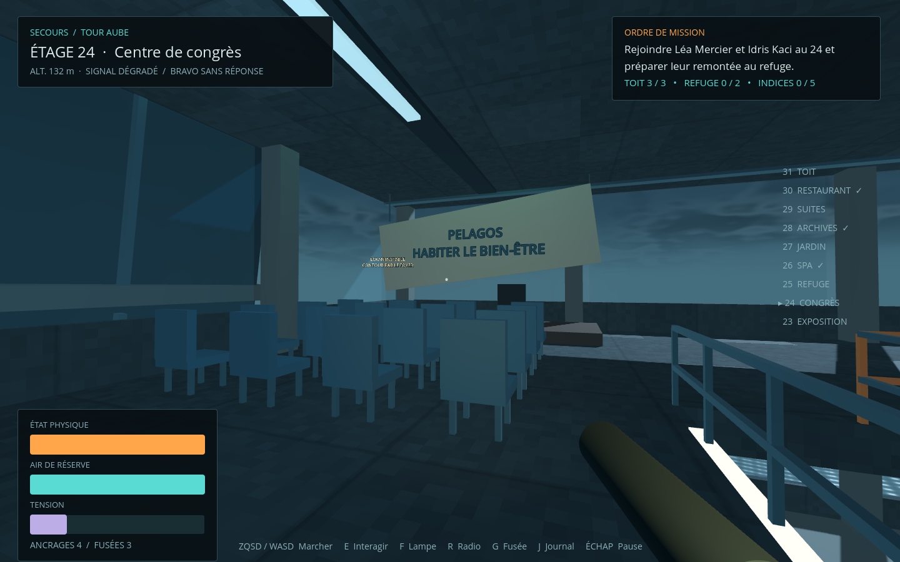
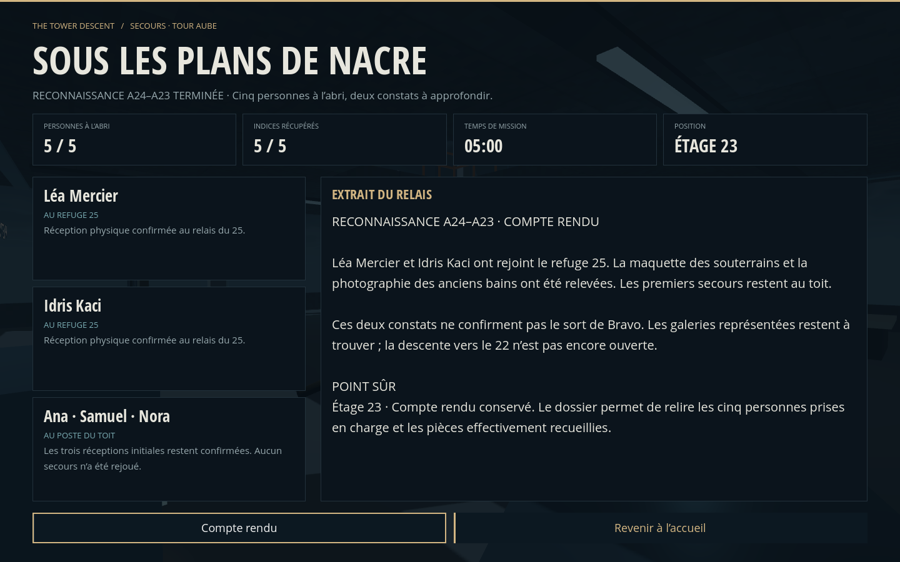

# Captures de la version 0.10

Ces 55 images proviennent du rendu natif Godot Compatibility en 1440 × 900. Elles montrent des états préparés : elles ne constituent pas l’enregistrement d’une partie humaine complète. Les personnages, décors et poses restent procéduraux.

Le [manifeste de construction](validation/v0.10/REVIEW_MANIFEST.json) identifie la source, les fichiers et leurs empreintes. La [revue visuelle](validation/v0.10/VISUAL_REVIEW.json) consigne les observations sur les images exactes ; [l’approbation de livraison](../.review/v0.10/approval.json) désigne les fichiers acceptés.

## Du refuge à l’exposition

Le congrès, l’accompagnement du groupe, le rappel vers le 23 et les deux relevés forment la continuation. Les captures d’escorte et de réception utilisent des positions préparées ; les déplacements et collisions sont vérifiés séparément par les suites de parcours.

| Capture | État présenté |
| --- | --- |
| [01_bilan_poursuite.png](captures/v0.10/continuation/01_bilan_poursuite.png) | Bilan supérieur conservé et bouton de poursuite vers le congrès |
| [02_escalier_25_24.png](captures/v0.10/continuation/02_escalier_25_24.png) | Accès nord à l’escalier local, séparé de la liaison 26–25 |
| [03_congres_auditorium.png](captures/v0.10/continuation/03_congres_auditorium.png) | Auditorium du congrès et écran Pelagos incliné, foyer de secours libre |
| [04_cabine_signes.png](captures/v0.10/continuation/04_cabine_signes.png) | Léa Mercier et Idris Kaci attendent un signe visible dans la cabine |
| [05_escorte_escalier.png](captures/v0.10/continuation/05_escorte_escalier.png) | États préparés des deux personnes sur la volée nord, vers le refuge |
| [06_reception_refuge.png](captures/v0.10/continuation/06_reception_refuge.png) | Réception stable préparée des deux personnes dans le refuge 25 |
| [07_rappel_24_23.png](captures/v0.10/continuation/07_rappel_24_23.png) | Nouvelle ligne entre congrès et exposition avec descendeur et mesures actives |
| [08_maquette_souterrains.png](captures/v0.10/continuation/08_maquette_souterrains.png) | Maquette des deux tours et volumes absents du plan touristique actuel |
| [09_archive_bains.png](captures/v0.10/continuation/09_archive_bains.png) | Panneau d’archive procédural des anciens bains, forme de porte et légende |
| [10_remanence_exposition.png](captures/v0.10/continuation/10_remanence_exposition.png) | Routine facultative E01 à l’écart du passage, sans attaque ni dégâts |
| [11_dossier_nacre.png](captures/v0.10/continuation/11_dossier_nacre.png) | Dossier des cinq pièces effectivement présentes dans l’instantané préparé |
| [12_bilan_reconnaissance.png](captures/v0.10/continuation/12_bilan_reconnaissance.png) | Compte rendu au 23, deux réceptions au refuge et trois au toit conservées |
| [13_menu_exposition.png](captures/v0.10/continuation/13_menu_exposition.png) | Accueil contextuel sur l’exposition au dernier point sûr enregistré |

## Secteur initial conservé

Ces 42 vues sont recapturées avec le runtime 0.10. Elles couvrent l’accueil, l’approche, les secours, les lectures, le dossier, l’épilogue, les perceptions et les six premières liaisons.

| Capture | État présenté |
| --- | --- |
| [01_menu_arrivee.png](captures/v0.10/baseline/01_menu_arrivee.png) | Menu initial, deux tours intactes, aucune sauvegarde |
| [02_options.png](captures/v0.10/baseline/02_options.png) | Options avant la partie |
| [03_nouvelle_intervention.png](captures/v0.10/baseline/03_nouvelle_intervention.png) | Préparation de la première intervention |
| [04_signature_studio.png](captures/v0.10/baseline/04_signature_studio.png) | Signature du studio, carton à deux secondes |
| [05_titre.png](captures/v0.10/baseline/05_titre.png) | Révélation du titre à onze secondes |
| [06_approche_03.png](captures/v0.10/baseline/06_approche_03.png) | Approche en jeu, état préparé à 3 secondes |
| [06_approche_10.png](captures/v0.10/baseline/06_approche_10.png) | Approche en jeu, état préparé à 10 secondes |
| [06_approche_17.png](captures/v0.10/baseline/06_approche_17.png) | Approche en jeu, état préparé à 17 secondes |
| [06_approche_25.png](captures/v0.10/baseline/06_approche_25.png) | Approche en jeu, état préparé à 25 secondes |
| [07_pause_intro.png](captures/v0.10/baseline/07_pause_intro.png) | Pause pendant l’approche |
| [14_toit_equipe.png](captures/v0.10/baseline/14_toit_equipe.png) | Détail du toit : Alpha posé, porte et équipe dans leur état final |
| [15_portage.png](captures/v0.10/baseline/15_portage.png) | Portage d’Ana : harnais, personne et mains visibles, objectif dégagé |
| [16_treuillage.png](captures/v0.10/baseline/16_treuillage.png) | Remontée d’Ana dans le puits : harnais et câble sous tension |
| [17_reception.png](captures/v0.10/baseline/17_reception.png) | Réception confirmée, transfert d’Ana vers l’abri avec l’équipe médicale |
| [18_meteo_toit.png](captures/v0.10/baseline/18_meteo_toit.png) | Atmosphère maritime : plafond nuageux, pluie extérieure et horizon de Nacre |
| [19_options_pause.png](captures/v0.10/baseline/19_options_pause.png) | Réglages complets accessibles pendant une intervention suspendue |
| [11_inspection_toit.png](captures/v0.10/baseline/11_inspection_toit.png) | Fiche du registre de réception, avant les sauvetages |
| [12_inspection_archives.png](captures/v0.10/baseline/12_inspection_archives.png) | Fiche des archives, avant l’incident structurel |
| [13_inspection_apres.png](captures/v0.10/baseline/13_inspection_apres.png) | Même fiche des archives après l’impact confirmé, consigne actualisée |
| [08_menu_archives.png](captures/v0.10/baseline/08_menu_archives.png) | Accueil au point sûr du 28 après la réplique |
| [09_dossier_apres.png](captures/v0.10/baseline/09_dossier_apres.png) | Dossier actualisé après l’impact confirmé |
| [20_journal_situation.png](captures/v0.10/baseline/20_journal_situation.png) | Journal de l’intervention en cours : situation, une réception et un indice confirmés |
| [21_journal_rescapes.png](captures/v0.10/baseline/21_journal_rescapes.png) | Journal de l’intervention en cours : survivors, une réception et un indice confirmés |
| [22_journal_indices.png](captures/v0.10/baseline/22_journal_indices.png) | Journal de l’intervention en cours : clues, une réception et un indice confirmés |
| [23_journal_transmissions.png](captures/v0.10/baseline/23_journal_transmissions.png) | Journal de l’intervention en cours : transmissions, une réception et un indice confirmés |
| [24_epilogue_02.png](captures/v0.10/baseline/24_epilogue_02.png) | Épilogue en jeu : plan 1 à 2 secondes, trois personnes réceptionnées |
| [24_epilogue_07.png](captures/v0.10/baseline/24_epilogue_07.png) | Épilogue en jeu : plan 2 à 7 secondes, trois personnes réceptionnées |
| [24_epilogue_12.png](captures/v0.10/baseline/24_epilogue_12.png) | Épilogue en jeu : plan 3 à 12 secondes, trois personnes réceptionnées |
| [25_bilan_refuge.png](captures/v0.10/baseline/25_bilan_refuge.png) | Bilan nominatif au refuge : trois réceptions, deux indices et historique de cette intervention |
| [10_menu_refuge.png](captures/v0.10/baseline/10_menu_refuge.png) | Accueil après une intervention terminée, point sûr du refuge |
| [26_suites_presence.png](captures/v0.10/baseline/26_suites_presence.png) | Manifestation des suites 29 : pose périphérique préparée, directeur avancé réellement de 3,4 s, silhouette sans dégâts |
| [27_archives_traces.png](captures/v0.10/baseline/27_archives_traces.png) | Archives 28 : huit traces humides après impact, neuf secondes de présentation réelle, sans indice ajouté au journal |
| [28_spa_remanence.png](captures/v0.10/baseline/28_spa_remanence.png) | Spa 26 : seconde présence après extinction, attente calme et regard détourné, sans poursuite ni dommage |
| [29_station_rappel_toit.png](captures/v0.10/baseline/29_station_rappel_toit.png) | Repère bleu du rappel personnel toit–30, distinct du treuil orange ; pose initiale préparée |
| [30_rappel_descente.png](captures/v0.10/baseline/30_rappel_descente.png) | Descente contrôlée sur R31_30 : transfert et 1,25 s de mouvement réels, capsule, descendeur et HUD du rappel |
| [31_rappel_verrouille.png](captures/v0.10/baseline/31_rappel_verrouille.png) | Même liaison, verrouillage réel du descendeur : vitesse nulle, repos assuré et état visible |
| [34_rappel_remontee.png](captures/v0.10/baseline/34_rappel_remontee.png) | Remontée réelle depuis l’extrémité basse du rappel toit–30 : effort, vitesse et disponibilité de corde |
| [32_escalier_30_29.png](captures/v0.10/baseline/32_escalier_30_29.png) | Escalier local du restaurant 30 aux suites 29 : ouverture de dalle, première volée et signalétique |
| [33_escalier_palier.png](captures/v0.10/baseline/33_escalier_palier.png) | Palier intermédiaire du 30–29 : deux volées physiques, aucune entrée d’étage déclarée à mi-hauteur |
| [36_escalier_28_27.png](captures/v0.10/baseline/36_escalier_28_27.png) | Escalier local des archives 28 au jardin 27, vue préparée de la dalle ouverte et du passage intérieur |
| [37_escalier_26_25.png](captures/v0.10/baseline/37_escalier_26_25.png) | Dernier escalier local, du spa 26 au refuge 25 ; la cage s’arrête à la liaison prévue |
| [35_aide_deplacements.png](captures/v0.10/baseline/35_aide_deplacements.png) | Aide de mission : itinéraire des six liaisons, commandes de rappel, distinction des repères et treuil |

## Documents et limites

Le supplément Word/PDF a sa propre revue de six pages, distincte de ces images de jeu. La Bible complète 0.9 reste conservée. Les essais automatisés vérifient les sources et les ressources exportées sous Linux ; ils ne mesurent pas une partie Windows, une session WebAssembly ou les performances sur une machine de joueur.
