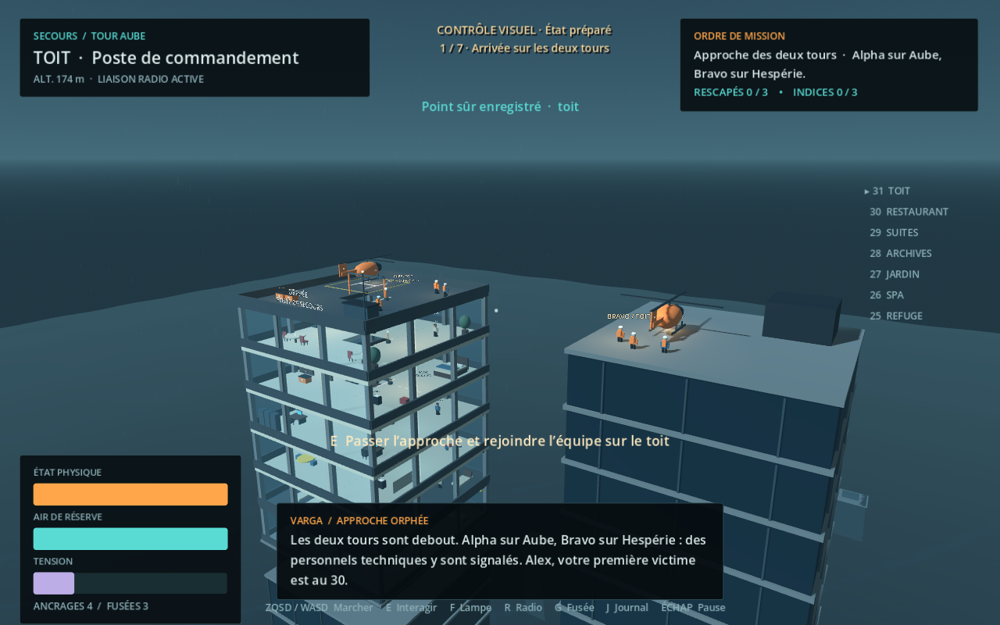
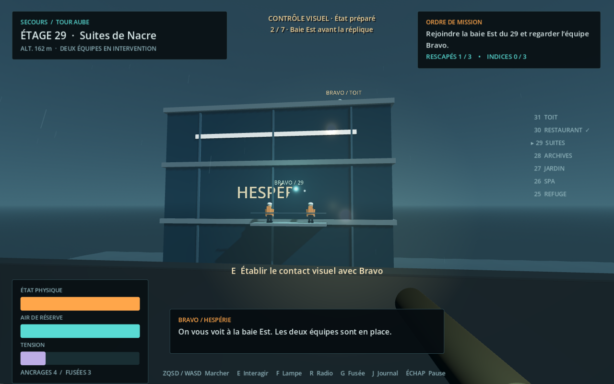
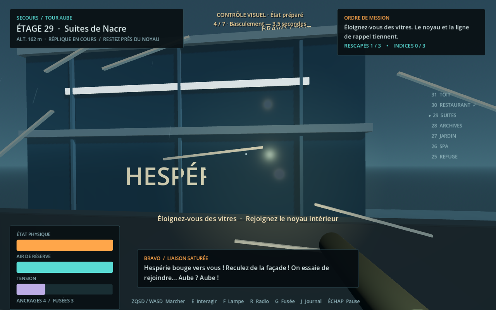

# Captures natives — version 0.2

Ces captures proviennent du rendu natif de Godot 4.7.2, dans la scène de contrôle `prototype/tests/visual_incident_preview.tscn`. Celle-ci instancie le vrai jeu, son monde et son interface, puis prépare des états précis de la séquence. Elle utilise une sauvegarde isolée, coupe le son et désactive les entrées et le déroulement normal pendant chaque prise. Il s’agit d’une vérification du rendu d’états préparés, pas d’un enregistrement d’une partie humaine ni d’une mesure des performances.

Le menu, le début d’intervention, le toit et la pause ont également été inspectés en lançant normalement le projet. Les parcours et règles de progression sont vérifiés séparément par les suites décrites dans [l’état de livraison](ETAT_DE_LIVRAISON.md).

## Arrivée sur les deux tours intactes

## Contact avec Bravo depuis la baie du 29

## Basculement vers la façade d’Aube

## Toutes les prises

| Vue | État préparé |
| --- | --- |
| [01 — Arrivée](captures/v0.2/01_arrivee.png) | Approche à 3 secondes, tours droites, deux hélicoptères et équipes visibles |
| [02 — Baie intacte](captures/v0.2/02_baie_intacte.png) | Après le premier sauvetage, observation de Bravo |
| [03 — Réplique](captures/v0.2/03_replique.png) | Phase de secousse à 3 secondes |
| [04 — Basculement](captures/v0.2/04_basculement.png) | Phase d’effondrement à 3,5 secondes |
| [05 — Impact](captures/v0.2/05_impact.png) | Impact à 1,2 seconde ; façade voisine au contact devant le joueur |
| [06 — Après-choc](captures/v0.2/06_apres.png) | État permanent, même position au bord de la baie ; la façade obstrue cette vue |
| [07 — Détour du 28](captures/v0.2/07_detour28.png) | Obstacle dans le passage Est, balisage vers le noyau |

Pour reproduire ces prises, ouvrir le projet Godot, ouvrir la scène de contrôle et appuyer sur F6. Les PNG sont écrits dans `prototype/tests/visual_output/`, dossier exclu de Git et des distributions. F8 arrête la scène de contrôle. Les huit suites de tests et la scène de capture sont exclues des exports Windows et Web.
