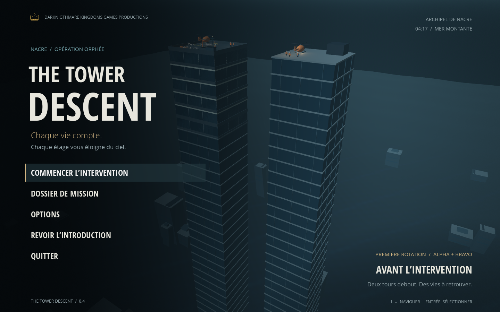
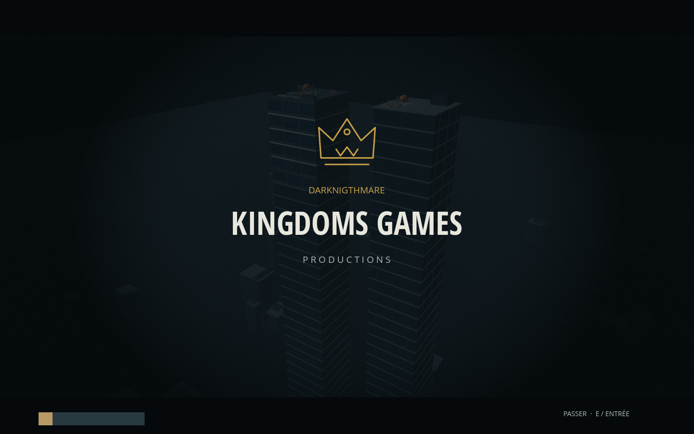
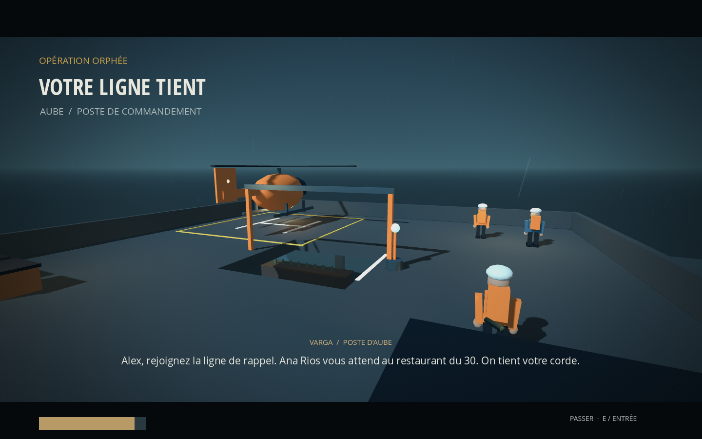
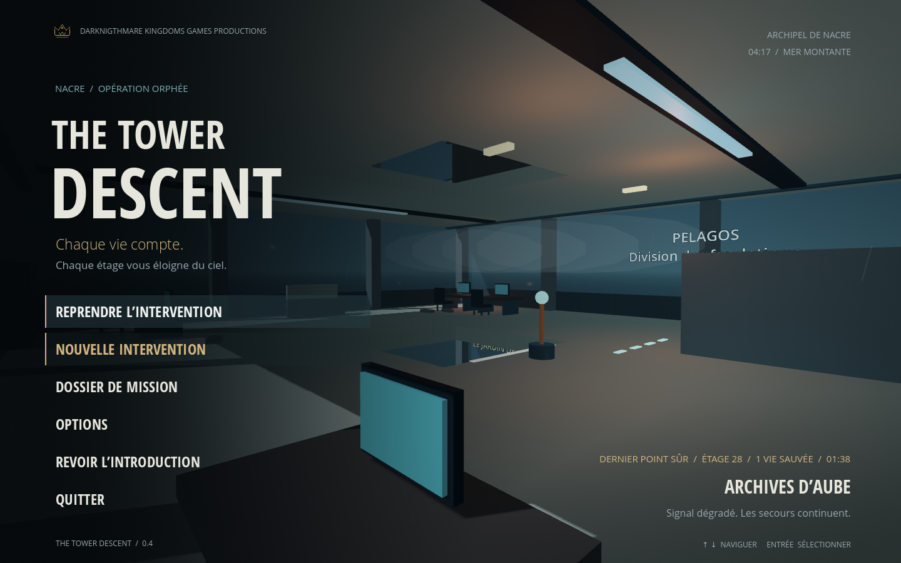

# Captures natives — accueil et cinématiques 0.4

Les treize images de ce dossier proviennent du **véritable rendu Godot 4.7.2**, méthode Compatibility, à **1440 × 900**. Le scénario prépare des états de contrôle : il ne représente pas une partie humaine complète. Les images servent à vérifier les cadrages, la composition, les sous-titres et les écrans de navigation.

## Provenance reproductible

- Source évaluée : [`c3f3aa23cd637c798be7be6b9cc78ef565293510`](https://github.com/darknigthmare/The-Descents/commit/c3f3aa23cd637c798be7be6b9cc78ef565293510).
- Exécution : [GitHub Actions — Cinematic review](https://github.com/darknigthmare/The-Descents/actions/runs/45459977356), terminée avec succès.
- Captures enregistrées dans le commit [`4094f29`](https://github.com/darknigthmare/The-Descents/commit/4094f29d23fdc17c4b0e926787b6a6e514a1918a).
- Scénario : `prototype/tests/visual_frontend_preview.gd` et scène associée.
- Workflow : `.github/workflows/cinematic-review.yml` ; Godot natif avec Xvfb et rendu logiciel Mesa sous Linux.
- Tailles, SHA256 et caractéristiques du moteur : [CI_PROVENANCE.json](captures/v0.4/CI_PROVENANCE.json) et [MANIFEST.json](captures/v0.4/MANIFEST.json).

Le workflow vérifie le SHA256 de l’archive du moteur avant de l’exécuter. Le scénario utilise une sauvegarde et des préférences d’essai distinctes de celles du joueur. Il prépare les états, attend le rendu, enregistre les PNG et nettoie ses fichiers d’essai. Le commit automatique des captures ne se fait que si la branche pointe encore sur la révision évaluée.

## Vues contrôlées

| Fichier | État présenté |
| --- | --- |
| [01_menu_arrivee.png](captures/v0.4/01_menu_arrivee.png) | Menu initial, deux tours intactes, aucune sauvegarde |
| [02_options.png](captures/v0.4/02_options.png) | Options avant la partie |
| [03_nouvelle_intervention.png](captures/v0.4/03_nouvelle_intervention.png) | Préparation de la première intervention |
| [04_signature_studio.png](captures/v0.4/04_signature_studio.png) | Signature du studio, carton à deux secondes |
| [05_titre.png](captures/v0.4/05_titre.png) | Révélation du titre à onze secondes |
| [06_approche_03.png](captures/v0.4/06_approche_03.png) | Approche en jeu, état préparé à 3 secondes |
| [06_approche_10.png](captures/v0.4/06_approche_10.png) | Approche en jeu, état préparé à 10 secondes |
| [06_approche_17.png](captures/v0.4/06_approche_17.png) | Approche en jeu, état préparé à 17 secondes |
| [06_approche_25.png](captures/v0.4/06_approche_25.png) | Approche en jeu, état préparé à 25 secondes |
| [07_pause_intro.png](captures/v0.4/07_pause_intro.png) | Pause pendant l’approche |
| [08_menu_archives.png](captures/v0.4/08_menu_archives.png) | Accueil au point sûr du 28 après la réplique |
| [09_dossier_apres.png](captures/v0.4/09_dossier_apres.png) | Dossier actualisé après l’impact confirmé |
| [10_menu_refuge.png](captures/v0.4/10_menu_refuge.png) | Accueil après une intervention terminée, point sûr du refuge |

## Corrections issues de la première passe

La première passe a révélé que le verre presque transparent faisait lire les six étages supérieurs d’Aube comme une coupe ouverte. Une face extérieure opaque, orientée vers l’extérieur et retirée avec sa vitre lors de l’impact, ferme maintenant chaque baie. La façade inférieure rejoint correctement le premier plancher jouable. Les vues depuis l’intérieur restent ouvertes vers l’extérieur ; les collisions et routes de secours sont inchangées.

Les annotations flottantes d’interaction encombraient aussi le fond des accueils d’étage et de refuge. Elles appartiennent désormais à une couche visible par la caméra du joueur et exclue de la caméra de présentation. Les enseignes physiques restent dans le décor. Enfin, le dernier plan a été déplacé pour éviter l’antenne au premier plan, et le bilan affiche « 1 vie sauvée » au singulier.

Le second jeu de treize images correspond à ces corrections. Le menu initial présente deux façades continues ; le plan final laisse lire le puits, les équipes et la prise en main. Les vues d’archives et de refuge conservent le décor correspondant à la sauvegarde, avec une interface dégagée.

## Aperçus

### Accueil initial

### Signature du studio

### Dernier plan de l’arrivée

### Accueil après un point sûr au 28

## Portée de la revue

Le relevé de revue visuelle est conservé dans [VISUAL_REVIEW.json](validation/v0.4/VISUAL_REVIEW.json). Il s’agit d’une inspection des images par les assistants de travail, pas d’un test joueur humain. La capture prépare les états de sauvegarde et les moments de cinématique ; les règles de transition et de persistance sont contrôlées séparément par les suites automatisées.

Ces images ne certifient pas une fréquence d’images, le rendu WebGL, l’exécution sous Windows ni le mixage audible. Elles montrent une direction de présentation réalisée avec les géométries de prototype. Les modèles, animations et décors définitifs restent un jalon de production décrit dans la bible.
