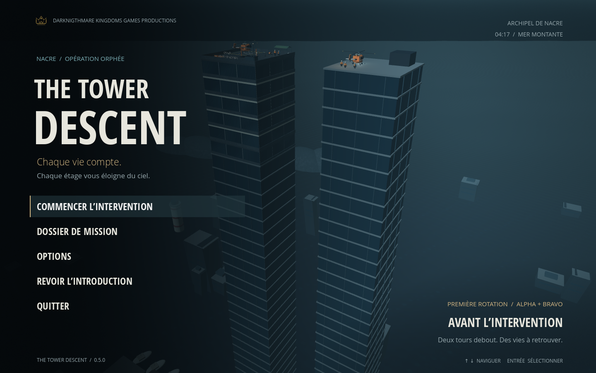
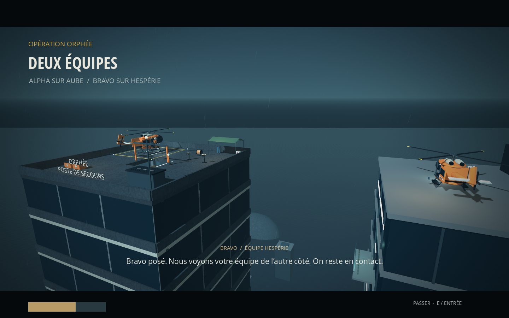
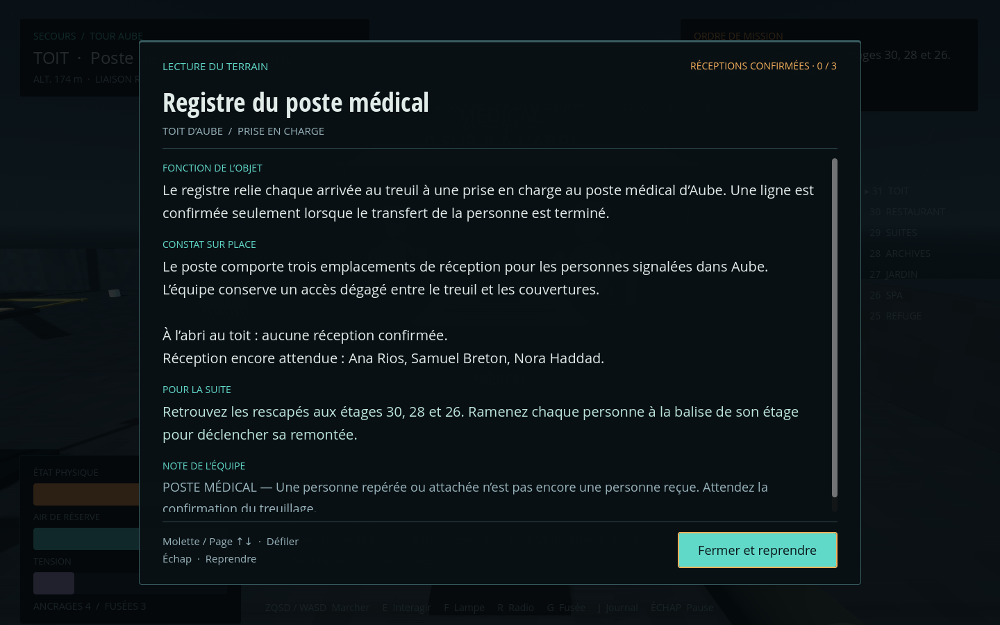
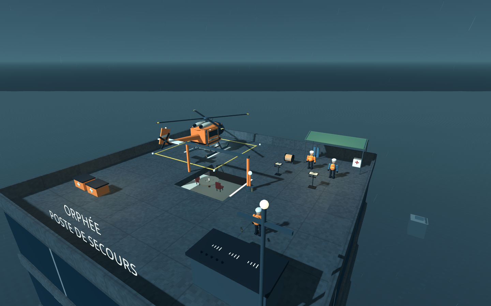

# Captures natives — arrivée animée et observations 0.5

Les dix-sept images de cette livraison proviennent du **rendu natif Godot 4.7.2**, méthode Compatibility, à **1440 × 900**. Elles montrent l’accueil, la signature du studio, quatre moments de la dépose, les équipes et les nouvelles fiches contextuelles. Le scénario prépare des états de contrôle ; il ne représente pas une partie humaine complète.

## Provenance reproductible

- Source du lot corrigé : [`08e8cb998194921f93a6e34fd54b898f14427533`](https://github.com/darknigthmare/The-Descents/commit/08e8cb998194921f93a6e34fd54b898f14427533).
- Exécution : [GitHub Actions — Cinematic review](https://github.com/darknigthmare/The-Descents/actions/runs/45479382645).
- Captures enregistrées dans le commit [`5441f527`](https://github.com/darknigthmare/The-Descents/commit/5441f527b72c3e7bc01b095afd7fd87d8e513c48), après réussite du rendu.
- Scénario : `prototype/tests/visual_frontend_preview.gd` et scène associée.
- Workflow : `.github/workflows/cinematic-review.yml`, avec Godot natif, Xvfb et rendu logiciel Mesa sous Linux.
- Demande explicite : `.review/v0.5/request.json`, contenant les empreintes du runtime, du scénario et du rapport de vérification.
- Tailles, SHA256 et caractéristiques du moteur : [CI_PROVENANCE.json](captures/v0.5/CI_PROVENANCE.json) et [MANIFEST.json](captures/v0.5/MANIFEST.json).
- Revue des images : [VISUAL_REVIEW.json](validation/v0.5/VISUAL_REVIEW.json).

Le workflow vérifie l’archive du moteur et les empreintes de la demande avant le rendu. Une modification ordinaire des sources ne déclenche pas implicitement un nouveau lot. Le scénario utilise des sauvegardes et préférences d’essai isolées, attend les images du moteur, enregistre les PNG et nettoie ses états. Le commit automatique des captures n’est autorisé que si la branche pointe encore sur la révision évaluée.

## Vues contrôlées

| Fichier | État présenté |
| --- | --- |
| [01_menu_arrivee.png](captures/v0.5/01_menu_arrivee.png) | Accueil initial, deux tours intactes et version du projet dans le pied |
| [02_options.png](captures/v0.5/02_options.png) | Réglages de confort avant l’intervention |
| [03_nouvelle_intervention.png](captures/v0.5/03_nouvelle_intervention.png) | Préparation de la première intervention |
| [04_signature_studio.png](captures/v0.5/04_signature_studio.png) | Signature du studio à deux secondes |
| [05_titre.png](captures/v0.5/05_titre.png) | Titre du jeu à onze secondes |
| [06_approche_03.png](captures/v0.5/06_approche_03.png) | Approche au-dessus de Nacre ; deux appareils en vol |
| [06_approche_10.png](captures/v0.5/06_approche_10.png) | Posés successifs : Bravo près du toit et Alpha encore en approche |
| [06_approche_17.png](captures/v0.5/06_approche_17.png) | Cabine ouverte et début du déploiement d’Alpha |
| [06_approche_25.png](captures/v0.5/06_approche_25.png) | Équipes en poste, fermeture des portes et vue vers la prise en main |
| [07_pause_intro.png](captures/v0.5/07_pause_intro.png) | Pause pendant la séquence de dépose |
| [08_menu_archives.png](captures/v0.5/08_menu_archives.png) | Accueil depuis le point sûr du 28 après l’impact |
| [09_dossier_apres.png](captures/v0.5/09_dossier_apres.png) | Dossier actualisé avec liaison perdue et trajet modifié |
| [10_menu_refuge.png](captures/v0.5/10_menu_refuge.png) | Accueil d’une intervention achevée au refuge |
| [11_inspection_toit.png](captures/v0.5/11_inspection_toit.png) | Registre du poste médical, personnes confirmées et attendues |
| [12_inspection_archives.png](captures/v0.5/12_inspection_archives.png) | Dossier de maintenance avant l’impact, HUD de l’étage 28 |
| [13_inspection_apres.png](captures/v0.5/13_inspection_apres.png) | Même dossier après l’impact, consigne adaptée au détour |
| [14_toit_equipe.png](captures/v0.5/14_toit_equipe.png) | Hélicoptère détaillé, poste médical et membres d’Alpha |

## Corrections issues de la revue

Le premier lot a été produit par [l’exécution 45476972426](https://github.com/darknigthmare/The-Descents/actions/runs/45476972426). Il a permis de relever cinq points précis avant les exports.

Le pied de l’accueil affichait encore « 0.4 » ; il lit maintenant la version définie par le projet. Le bouton de fermeture d’une fiche utilisait un texte clair sur un fond de focus clair ; la couleur du texte au clavier est désormais sombre. Le scénario de contrôle rafraîchit le HUD après avoir préparé une position aux archives, afin de montrer le niveau 28 derrière la fiche.

Le plan d’eau avait une limite finie visible en V dans les vues larges. Sa surface est passée de 1 600 à 6 400 mètres de côté. Les vagues utilisent des coordonnées spatiales : leur échelle ne change pas avec cet agrandissement. Aucun collider ni règle de mission n’est ajouté. Enfin, le cadrage de la vue 14 a été élargi pour garder les membres d’Alpha avec l’appareil et le poste médical.

La revue du lot corrigé enregistre une note pour chacune des dix-sept images. La trace relie les images inspectées à leur SHA256 et au commit source, séparément des vérifications de logique.

## Aperçus

### Accueil initial

### Déploiement des équipes

### Observation du poste médical

### Appareil et équipe sur le toit

## Portée de la revue

La revue est effectuée par les assistants de travail sur les images natives, et non par un joueur humain. Les moments de cinématique et les états de sauvegarde sont préparés par le scénario. Le passage, la pause, les conditions d’inspection, les trajectoires et la persistance sont contrôlés séparément par les dix-huit suites automatisées.

Une image fixe ne valide pas la fluidité des mouvements, le débit d’images ou le mixage audible. Le lot ne certifie pas le rendu WebGL ni l’exécution de l’application sous Windows. Il montre la présentation réelle de la maquette Godot, avec modèles et matériaux procéduraux. Les ressources artistiques définitives restent un jalon de production décrit dans la bible.
