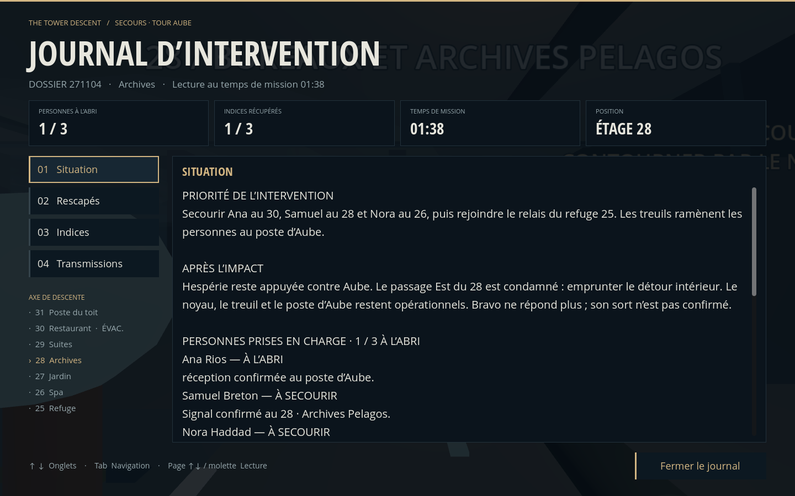
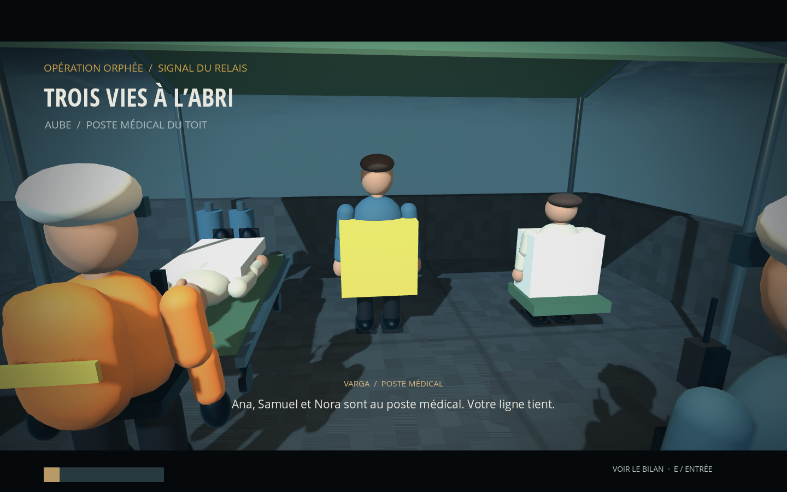
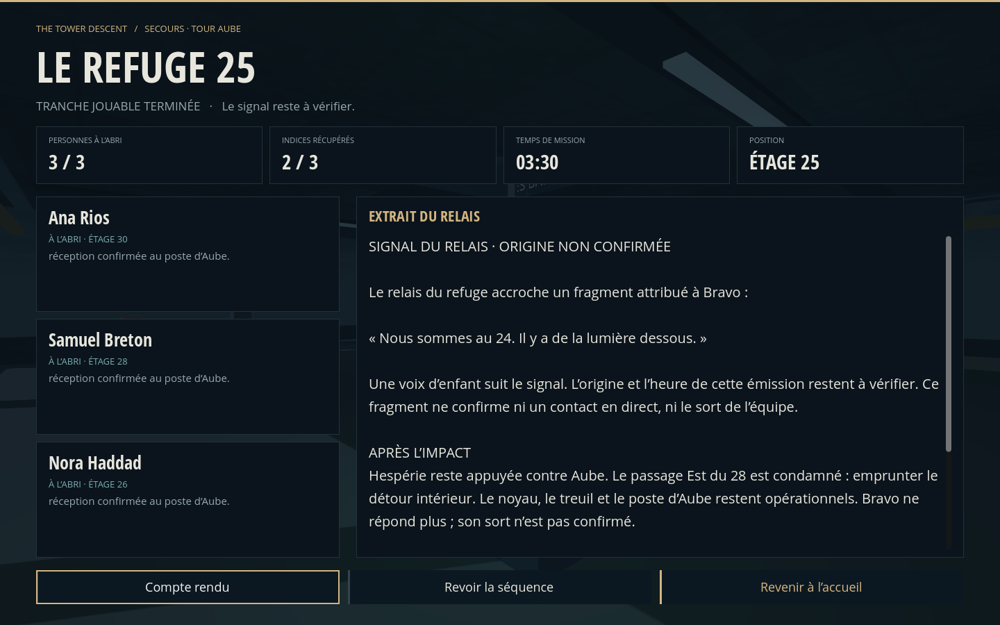

# Captures natives examinées — The Tower Descent 0.7

Les **30 captures natives de la v0.7** ont été produites par la [construction de revue du 25 novembre 2026](https://github.com/darknigthmare/The-Descents/actions/runs/45557532133), puis ouvertes et examinées une à une dans leur format PNG original. La [revue visuelle](validation/v0.7/VISUAL_REVIEW.json) conserve un verdict, une observation et l’empreinte de chaque fichier. L’[état de livraison](ETAT_DE_LIVRAISON.md) relie ces images aux tests et aux documents.

Le lot utilise **Godot 4.7.2 officiel**, rendu **Compatibility / OpenGL 3**, à **1440 × 900**, sous Linux avec Xvfb et Mesa. Les états sont préparés par la scène de capture, puis rendus par le moteur : scènes, menus, personnages procéduraux et interfaces du jeu. Les 22 vues de la version précédente ont été recapturées avec le runtime v0.7 ; aucune image historique n’a été réétiquetée comme une nouvelle preuve.

## Provenance vérifiée

| Preuve | Contenu |
| --- | --- |
| `.review/v0.7/request.json` | Runtime, fixture, rapport de tests et noms exacts des captures demandées |
| `captures/v0.7/MANIFEST.json` | Les trente états effectivement produits, sans nom manquant ni doublon |
| `captures/v0.7/CI_PROVENANCE.json` | Commit de capture, moteur, méthode, exécution, dimensions, octets et empreintes des PNG |
| `captures/v0.7/REVIEW_DERIVATIVES.json` | Correspondance vérifiée des grands PNG et de leurs copies JPEG destinées à la lecture |
| `validation/v0.7/VISUAL_REVIEW.json` | Fichiers réellement examinés, empreintes exactes, observations et décision de revue |

Les PNG restent les preuves natives. Pour les lecteurs qui ne peuvent pas afficher un PNG volumineux, le pipeline peut produire une copie JPEG de même dimension, qualité 95 et chroma 4:4:4, sans recadrage ni redimensionnement. Cette copie utilise une compression avec perte ; le manifeste conserve les deux empreintes et vérifie que l’original n’a pas changé. La revue précise le support affiché. Produire un PNG ou un JPEG ne vaut jamais approbation visuelle.

Les trente approbations de cette version portent sur les **PNG originaux**. Le commit de capture est `ca8753a510486e969040460ec0f5db9b75253091` ; les fichiers ont été publiés au commit `e8e376c2f88b008728aed3e1f4a3835c042eef63`. Les essais d’interface complètent les images pour le défilement, le focus et les transitions.

## Aperçu de la continuation

## Ouverture et accueil

| Capture | État présenté |
| --- | --- |
| [01 — Accueil avant intervention](captures/v0.7/01_menu_arrivee.png) | Tours intactes, signature visuelle, commandes et contexte initial |
| [02 — Options](captures/v0.7/02_options.png) | Volume, regard, mise en scène et actions du panneau complet |
| [03 — Nouvelle intervention](captures/v0.7/03_nouvelle_intervention.png) | Briefing, disposition du niveau et confirmation du départ |
| [04 — Signature du studio](captures/v0.7/04_signature_studio.png) | Identité du studio dans le prologue de quinze secondes |
| [05 — Titre](captures/v0.7/05_titre.png) | Présentation du titre et composition de la signature |
| [06 — Approche à 3 secondes](captures/v0.7/06_approche_03.png) | Plan large maritime et horizon brumeux |
| [06 — Approche à 10 secondes](captures/v0.7/06_approche_10.png) | Deux tours, deux appareils et répartition des équipes |
| [06 — Approche à 17 secondes](captures/v0.7/06_approche_17.png) | Dépose des groupes et liaison entre Aube et Hespérie |
| [06 — Approche à 25 secondes](captures/v0.7/06_approche_25.png) | Équipe du toit et raccord vers Alex |
| [07 — Pause de l’approche](captures/v0.7/07_pause_intro.png) | Séquence suspendue, reprise et options |
| [08 — Accueil aux archives](captures/v0.7/08_menu_archives.png) | Point sûr du 28, une personne reçue et reprise contextuelle |
| [09 — Dossier après le choc](captures/v0.7/09_dossier_apres.png) | Situation, équipe et parcours mis à jour après l’incident |
| [10 — Accueil au refuge](captures/v0.7/10_menu_refuge.png) | Intervention achevée au 25, trois personnes reçues |

## Terrain, secours et confort

| Capture | État présenté |
| --- | --- |
| [11 — Registre du toit](captures/v0.7/11_inspection_toit.png) | Consultation médicale avant les sauvetages |
| [12 — Archives avant l’incident](captures/v0.7/12_inspection_archives.png) | Observation facultative et lecture du plan antérieur |
| [13 — Archives après l’incident](captures/v0.7/13_inspection_apres.png) | Constat adapté aux dégâts et au passage condamné |
| [14 — Équipe au toit](captures/v0.7/14_toit_equipe.png) | Appareil, secours, portique, civière et abri |
| [15 — Portage](captures/v0.7/15_portage.png) | Ana visible dans le support de première personne, mains, sangles et route centrale |
| [16 — Treuillage](captures/v0.7/16_treuillage.png) | Montée à 1,8 seconde, panier, câble et avancement ; annotations flottantes suspendues |
| [17 — Réception](captures/v0.7/17_reception.png) | Transfert médical 1,8 seconde après la confirmation du toit |
| [18 — Météo du toit](captures/v0.7/18_meteo_toit.png) | Nuages, brume, pluie extérieure et lecture des deux tours |
| [19 — Options depuis la pause](captures/v0.7/19_options_pause.png) | Panneau partagé ouvert pendant une intervention suspendue |

## Dossier de mission et clôture

| Capture | État présenté |
| --- | --- |
| [20 — Journal Situation](captures/v0.7/20_journal_situation.png) | Intervention après impact, une réception et un indice confirmés ; point sûr, état structurel, ressources et derniers échanges |
| [21 — Journal Rescapés](captures/v0.7/21_journal_rescapes.png) | Trois noms, une réception confirmée et deux personnes encore à secourir ; distinction entre objectif et résultat |
| [22 — Journal Indices](captures/v0.7/22_journal_indices.png) | Texte de la pièce recueillie et emplacements non récupérés sans divulgation de leurs contenus |
| [23 — Journal Transmissions](captures/v0.7/23_journal_transmissions.png) | Historique de cette intervention, indicatifs et temps de mission, avec lecteur défilant |
| [24 — Épilogue à 2 secondes](captures/v0.7/24_epilogue_02.png) | Poste médical du toit, trois personnes reçues, premier carton et sous-titre de confirmation |
| [24 — Épilogue à 7 secondes](captures/v0.7/24_epilogue_07.png) | Terminal réel du refuge 25 et fragment attribué à Bravo, deuxième plan |
| [24 — Épilogue à 12 secondes](captures/v0.7/24_epilogue_12.png) | Vue extérieure des tours après impact, origine du signal non confirmée et aucune visite du 24 |
| [25 — Bilan du refuge](captures/v0.7/25_bilan_refuge.png) | Trois réceptions, deux indices dans l’état préparé, durée, ressources et accès au compte rendu, à la relecture et à l’accueil |

## Critères de revue

La liste de `tools/capture_evidence.py` constitue le contrat machine : exactement 30 noms, PNG natifs complets de 1440 × 900 et même runtime que les tests. Chaque image de ce catalogue doit être reliée à une entrée de provenance puis à une décision de revue portant sur ses octets finaux. Le ZIP Sources final conserve les trente PNG approuvés et leurs rapports.

Les vues d’ouverture doivent conserver la géographie des deux tours, les silhouettes sur le ciel, la cohérence du point sûr, les quatre instants d’arrivée et des commandes lisibles. Les plans de terrain contrôlent les fiches, la lecture du harnais et du câble, la réception réelle, les raccords de l’horizon et les options depuis une pause. Leurs défauts éventuels doivent être corrigés dans le jeu puis recapturés.

Les quatre vues du journal doivent garder titres, onglets, compteurs, noms et contenu dans le cadre. L’état confirmé du secours doit être lisible sans supposer qu’un transport vaut réception. Un indice non collecté ne doit pas divulguer son récit. Le dossier doit rester lisible pendant que le monde est suspendu ; le défilement est vérifié séparément par les tests d’interface.

Les trois plans de clôture doivent montrer les objets et personnes réels, avec une caméra dégagée de l’abri, du terminal et des façades. Les sous-titres ne doivent pas concurrencer le bouton **Voir le bilan**. Le bilan doit présenter les noms, les preuves de cet état et ses trois actions sans texte coupé. La prise de vue ne doit inventer ni personnage reçu ni portion de campagne jouable.

## Portée des images

Le portage, le treuil et la réception sont déclenchés par les actions du jeu puis observés à des instants préparés. L’arrivée et l’épilogue sont représentés par des images échantillonnées ; ces images ne constituent pas une vidéo des transitions. Les suites de logique et d’intégration complètent la revue pour la pause, le passage, la reprise et l’absence de duplication ou d’écriture lors d’une relecture.

Les modèles, poses, matériaux et paysages restent procéduraux. Le lot ne valide ni des assets photoréalistes définitifs, ni la qualité audible du mixage, ni une partie humaine sous Windows ou dans un navigateur, ni des performances sur matériel cible. La [procédure v0.7](VALIDATION_V0.7.md) conserve ces contrôles distincts.
